<div align="center">


# 🔐 P2P Secure Messenger · P2P Защитен месинджър

**Личен, децентрализиран, шифрован от край до край.**
**A private, decentralised, end-to-end encrypted messenger.**

[](#-тестове)
[](#-тестове)
[](#-как-да-го-пробвам)
[](#-език) [](https://dyrakarmy.online/)

### 🌍 Language / Език

[🇧🇬 **Български**](#-български) · [🇬🇧 **English**](#-english)

<a href="docs/public/assets/promo-bg.mp4"></a>
<a href="docs/public/assets/promo-en.mp4"></a>

▶️ Видео със звук: [български](docs/public/assets/promo-bg.mp4) · [English](docs/public/assets/promo-en.mp4)

</div>

---

<a id="-български"></a>

# 🇧🇬 Български

> Съобщенията се шифроват на устройството и се пращат **директно** между хората през WebRTC.
> Няма централен сървър, който пази съобщения, акаунти или телефонни номера.

*Състояние към 22 ноември 2026: работеща PWA за уеб и телефон; програми за Windows (инсталатор, portable, winget) и Linux (.deb, .rpm, AppImage, Flatpak); подписан APK за Android; сайт с меню и сваляне на [dyrakarmy.online](https://dyrakarmy.online/) на 8 езика; интерфейс на 6 езика; седем начина за първа връзка (QR, кратък код с PAKE, Bluetooth, QR + звук, QR + светлина, запознаване чрез общ приятел, Telegram бот) — виж [docs/CONNECTING.md](docs/CONNECTING.md); тестове на всички нива. Изходният код е отворен, тук; изданията и сайтът се публикуват в публичното репо [p2p-pure-releases](https://github.com/biramentv-ux/p2p-pure-releases). iOS проектът и TestFlight workflow-ът са написани, но не са пускани с Apple акаунт.*

## ✨ Какво може

| | Функция | Какво означава |
|---|---|---|
| 🪪 | **Профил без регистрация** | Passkey на устройството или парола → `did:key` (`z6Mk…`). Без имейл, телефон или SMS. |
| 🔑 | **Възстановяване с 12 думи** | BIP39. Записваш ги веднъж и ги ползваш на ново устройство. |
| 📷 | **Контакт с QR или кратък код** | Подписана покана. Краткият код е 10 знака, важи 10 минути и работи веднъж. |
| 🛰️ | **Демо стая с PAKE** *(обновено)* | Превключвател „Локален (QR) / Демо (стая)“. Отдалеч единият отваря стая и казва код от 5 знака и 3 думи, например `K7M2Q · lemon-rocket-bridge`. Думите не стигат до сървъра: от тях двете устройства правят общ ключ (CPace), а поканата върви шифрована. |
| 🔊 | **QR + звук** *(ново)* | Единият показва QR, другият отговаря със звук (около 15 секунди), първият го слуша с микрофона. Без сървър ([docs/SOUND-PAIRING.md](docs/SOUND-PAIRING.md)). |
| 💡 | **QR + светлина** *(ново)* | Единият показва QR, другият го сканира и отговаря с бавна анимация от цветни квадратчета на екрана (5–8 секунди), която първият чете с камерата. Най-много 3 смени в секунда, без червено, с предупреждение преди началото; при „намалено движение“ се показва QR. Без сървър ([docs/LIGHT-PAIRING.md](docs/LIGHT-PAIRING.md)). |
| 🤝 | **Запознаване чрез общ приятел** *(ново)* | Общ контакт препраща подписаните покани по вече шифрованите връзки. Без сървър; новият контакт започва като непроверен ([docs/INTRODUCTIONS.md](docs/INTRODUCTIONS.md)). |
| 📡 | **Bluetooth** *(ново)* | В приложението за Android и iOS: поканата минава по BLE между два телефона наблизо ([docs/BLUETOOTH.md](docs/BLUETOOTH.md)). |
| 🔢 | **12 думи за проверка** | Двамата виждат едни и същи 12 думи (3 групи по 4), изчислени от публичните X25519 ключове (v3, 132 бита). Ако съвпадат, никой не стои по средата. |
| 💬 | **Шифровани чатове** | Double Ratchet. Историята и контактите се пазят в IndexedDB, шифровани с AES-GCM. |
| 📎 | **Файлове до 100 MB** *(обновено)* | Всякакви файлове и видео, директно между устройствата. Получателят приема или отказва; файлове до 25 MB остават шифровани в историята. Ако връзката прекъсне, файлът продължава от същото място при следващото свързване (до 30 минути). |
| ⏱️ | **Изчезващи съобщения** *(ново)* | Таймер за всеки чат и група: 5 минути, 1 час, 1 ден или 1 седмица. Еднакъв е за всички в разговора; съобщенията и запазените файлове се трият от всички устройства ([docs/SECURITY-DEVICE.md](docs/SECURITY-DEVICE.md)). |
| 🔒 | **Заключване и бутон за паника** *(ново)* | Заключване след 1–30 минути или когато приложението е във фона. „Изтрий всичко от това устройство“ работи и от заключения екран ([docs/SECURITY-DEVICE.md](docs/SECURITY-DEVICE.md)). |
| 🖼️ | **Снимки, локация, изтриване** | Изтриване на чата и при двамата. Локацията се праща само при твое натискане. |
| 📞 | **Аудио и видео разговори** *(обновено)* | По същата директна връзка, медията е DTLS-SRTP. Смяна на камерата, споделяне на екрана, показател за качеството и по-ниско видео при слаба мрежа; при смяна на мрежата връзката се премества (ICE restart). |
| 🧭 | **Намиране отново през интернет** *(ново, по избор)* | Познат контакт се свързва без нов QR. Темата идва от общата ви тайна и се сменя на 15 минути; публични Nostr релета пренасят само шифрован текст. Изключено по подразбиране ([docs/PROTOCOL.md](docs/PROTOCOL.md) §9). |
| 📜 | **Протокол и модел на заплахите** *(ново)* | [docs/PROTOCOL.md](docs/PROTOCOL.md), [docs/THREAT_MODEL.md](docs/THREAT_MODEL.md), версия на протокола в handshake-а, поверително докладване на уязвимости и `security.txt`. |
| 👥 | **Групи до 9 души** *(обновено)* | Админ, име и снимка на групата. Файлове, снимки, видео до 50 MB и GIF от GIPHY; прекъснат файл продължава при следващото свързване. Новият член не вижда старата история; махането става и когато махнатият е офлайн. Всичко се пази шифровано. |
| 🪟 | **Windows** *(ново)* | Инсталатор без админ права, portable zip и `winget`. Цялото приложение е вътре. |
| 🐧 | **Linux** *(ново)* | `.deb`, `.rpm`, AppImage, Flatpak и `install.sh` с проверка на сумите. Цялото приложение е вътре. |
| 🎨 | **Нов дизайн** *(ново)* | „Запечатана поща“: небесно синьо и електрик пурпурно-розово, IBM Plex с кирилица, светъл и тъмен режим, AA контраст. |
| 🔔 | **Известия и звуци** *(ново)* | Само от познати: контакт или член на твоя група. Няколко синтезирани звука и гласа по избор, брой непрочетени в заглавието ([docs/NOTIFICATIONS.md](docs/NOTIFICATIONS.md)). |
| 📇 | **До 99 контакта** *(ново)* | Изричен лимит; при пълен списък приложението казва какво да направиш. |
| 📲 | **Местене на нов телефон** *(ново)* | Сканираш QR от старото устройство; профилът и контактите минават шифровано, без сървър, а старото се изтрива ([docs/MULTIDEVICE.md](docs/MULTIDEVICE.md)). |
| 🎵 | **Плейър и поставяне** *(ново)* | Музиката и гласовите файлове се пускат в чата; картинка се поставя с `Ctrl+V`. |
| 🛰️ | **Собствен TURN** *(ново, по избор)* | За мрежи, които блокират директната връзка. Нищо не е включено по подразбиране. |
| 🤖 | **Android APK** *(ново)* | Подписан, с проверка на подписа и без данни в резервните копия ([docs/ANDROID-APK.md](docs/ANDROID-APK.md)). Има и чернова за F-Droid. |
| 🧾 | **Подписан SBOM** *(ново)* | Всяко издание има SHA-256 суми и подписан (Sigstore) списък на зависимостите ([docs/SUPPLY-CHAIN.md](docs/SUPPLY-CHAIN.md)). |
| 🌍 | **6 езика в приложението** *(обновено)* | Български, English, Русский, Deutsch, Español, Português (Brasil). Сайтът е и на Français и 简体中文. |
| ⚡ | **Разширение за Chrome** | `Ctrl+Shift+M` отваря месинджъра. |

## 🔗 Начини за свързване

Седем начина за първата връзка. Подробно сравнение: [docs/CONNECTING.md](docs/CONNECTING.md).

| Начин | Къде | Сървър? | Повече |
|---|---|---|---|
| QR лице в лице | Заедно | Не | [CONNECTING.md](docs/CONNECTING.md) |
| Кратък код (5 знака и 3 думи, PAKE) | Отдалеч | Да: вижда номера на стаята и шифрован текст | [DEMO-SIGNALING.md](docs/DEMO-SIGNALING.md) |
| Bluetooth | Заедно, само в приложението за Android и iOS | Не за поканата | [BLUETOOTH.md](docs/BLUETOOTH.md) |
| QR + звук | Заедно | Не | [SOUND-PAIRING.md](docs/SOUND-PAIRING.md) |
| QR + светлина | Заедно, с камера (браузър и приложение) | Не | [LIGHT-PAIRING.md](docs/LIGHT-PAIRING.md), [CONNECTING.md](docs/CONNECTING.md) |
| Запознаване чрез общ приятел | Отдалеч, при общ контакт | Не | [INTRODUCTIONS.md](docs/INTRODUCTIONS.md) |
| Telegram бот или копиране на поканата | Отдалеч | Telegram вижда поканата | [telegram-bot-guide.md](docs/telegram-bot-guide.md) |

След всеки начин сравнете 12-те думи. Подписът пази от подправяне на поканата, но не от препращане при първия контакт.

## 🧭 Как работи

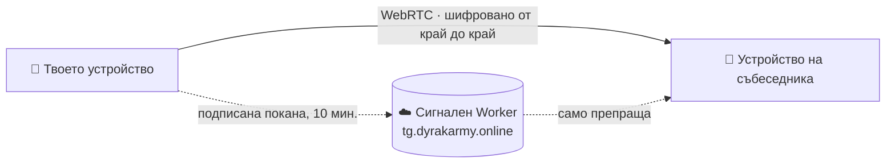

Сървърът (Cloudflare Worker) вижда кратките подписани покани от `/invite`, а в демо стаята само номера ѝ и шифрован текст. Не може да ги подправи и не вижда съобщенията, снимките или разговорите. Worker-ът не записва логове (наблюдаемостта е изключена, няма `console` в кода). Самата платформа Cloudflare обаче вижда IP адреси и адреси на заявките, както всеки хостинг; подробности в [SECURITY.md](SECURITY.md). Локалният режим (QR) не ползва сървър изобщо.

Сигнализацията е отделена от WebRTC (`src/signaling/`, интерфейс `ISignalingProvider`):

- **Локален** (`OfflineSignalingProvider`): поканата е подписан текст, показан като QR. Без мрежови заявки.
- **Демо** (`PakeSignalingProvider` върху `WebSocketSignalingProvider`): стая в Worker-а с 5-знаков номер и 3 думи, които остават на устройствата. Двете страни пускат CPace с думите, потвърждават ключа и чак тогава пращат поканата, шифрована (XChaCha20-Poly1305). Грешна дума проваля сдвояването; стаята не се ползва повторно. Старите клиенти с 10-знакови стаи още се приемат. Подробности: [docs/DEMO-SIGNALING.md](docs/DEMO-SIGNALING.md).

## 🎬 Урок: 7 начина да се свържете

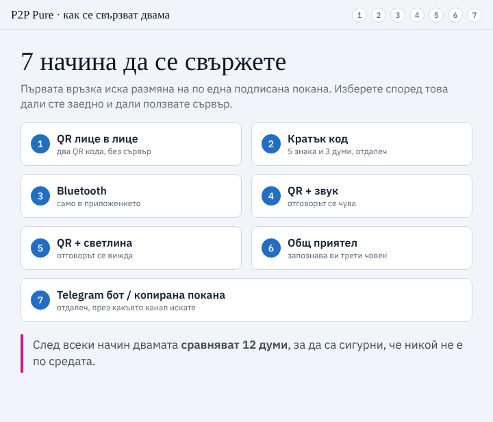

**Видео за всеки начин** (около 27 секунди, без звук; кликни картинката). На английски: [по-долу](#-tutorial-7-ways-to-connect).

<table>
<tr><td align="center"><a href="docs/public/assets/tutorial-qr-bg.mp4"></a><br><b>1. QR лице в лице</b></td><td align="center"><a href="docs/public/assets/tutorial-short-code-bg.mp4">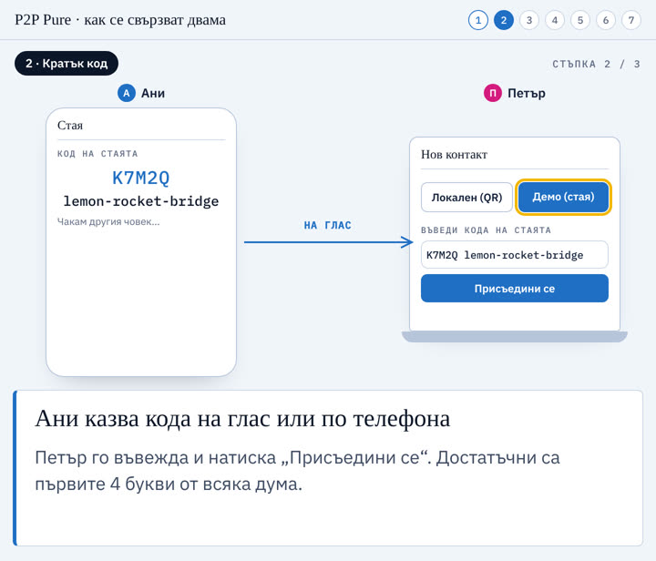</a><br><b>2. Кратък код</b></td><td align="center"><a href="docs/public/assets/tutorial-bluetooth-bg.mp4">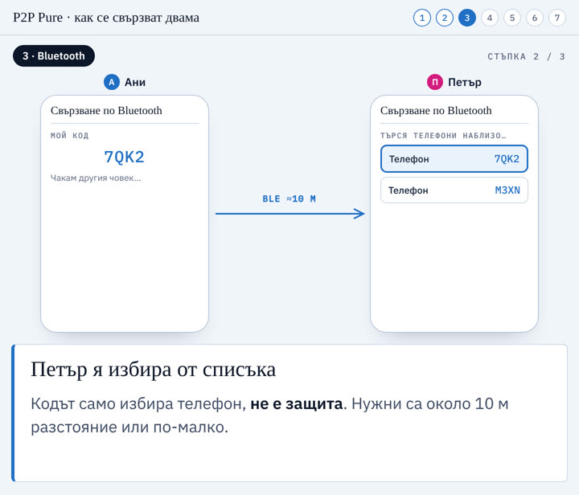</a><br><b>3. Bluetooth</b></td><td align="center"><a href="docs/public/assets/tutorial-sound-bg.mp4">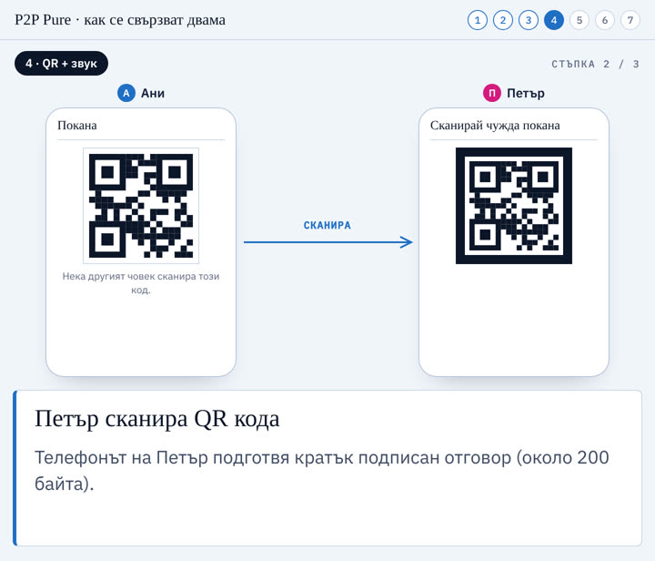</a><br><b>4. QR + звук</b></td></tr>
<tr><td align="center"><a href="docs/public/assets/tutorial-light-bg.mp4">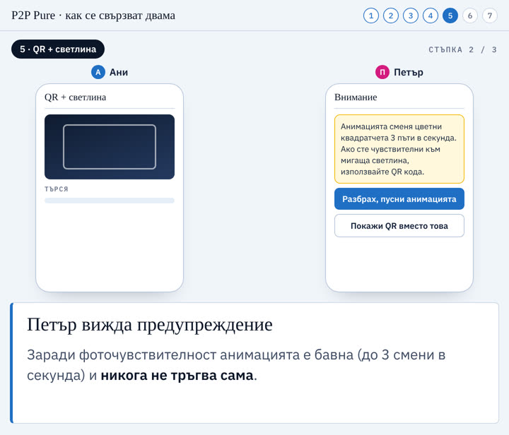</a><br><b>5. QR + светлина</b></td><td align="center"><a href="docs/public/assets/tutorial-introduction-bg.mp4">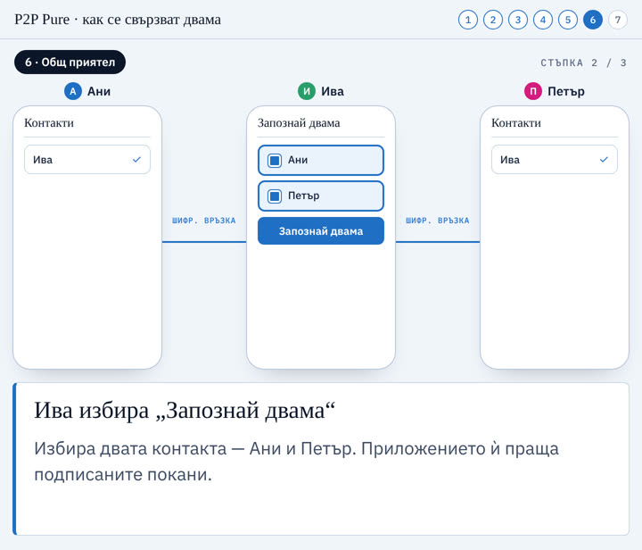</a><br><b>6. Общ приятел</b></td><td align="center"><a href="docs/public/assets/tutorial-telegram-bg.mp4">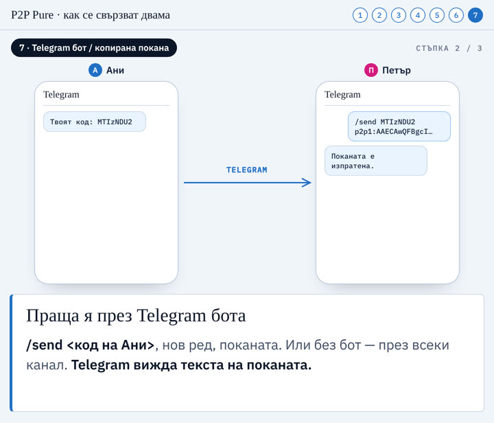</a><br><b>7. Telegram бот</b></td></tr>
</table>


1. **QR лице в лице.** „Локален (QR)“: единият показва QR, другият го сканира и показва свой QR в отговор. Без сървър.
2. **Кратък код.** „Демо (стая)“: код от 5 знака и 3 думи, казан на глас. Сървърът вижда само номера на стаята.
3. **Bluetooth.** Само в приложението: единият показва 4-знаков код, другият го избира от списъка.
4. **QR + звук.** QR в едната посока, в другата отговорът се чува (около 15 секунди, нужен е микрофон).
5. **QR + светлина.** QR в едната посока, в другата отговорът се чете от камерата като цветна анимация (3 до 8 секунди), след предупреждение за фоточувствителност.
6. **Общ приятел.** Той избира двама свои контакти с „Запознай двама“; и двамата приемат. Тримата трябва да са свързани едновременно.
7. **Telegram бот / копирана покана.** Поканата (`p2p1:…`) се праща през бота или през какъвто канал искате.

След всеки начин сравнете **12-те думи** по друг канал и натиснете „Думите съвпадат“. Сравнение на начините, сигурност и платформи: [docs/CONNECTING.md](docs/CONNECTING.md). Анимацията се прави със `node scripts/docs/tutorial-connect-gif.mjs`, видеата със `MODE=video node scripts/docs/tutorial-connect-gif.mjs`.

### Пътят на Ани и Петър от край до край

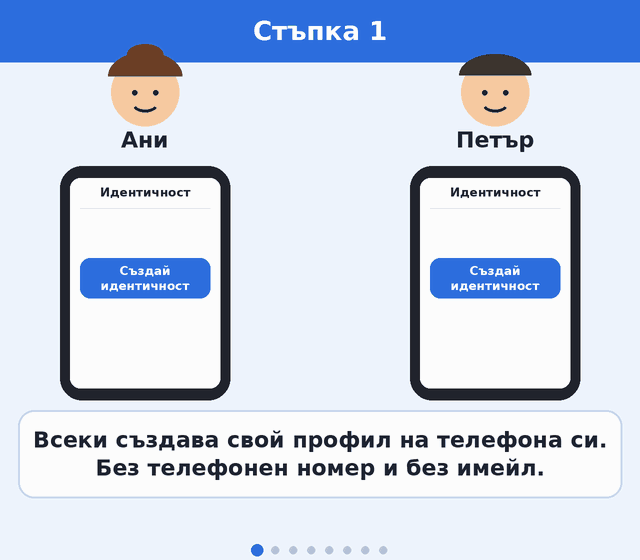

1. **Профил.** Всеки създава профил на своя телефон с passkey или парола и записва 12-те думи.
2. **Режим.** Избират „Локален (QR)“, ако са заедно, или „Демо (стая)“, ако са далеч. Има и други начини: Bluetooth, QR + звук, QR + светлина, общ приятел ([docs/CONNECTING.md](docs/CONNECTING.md)).
3. **Покана.** Ани натиска „Покажи моята покана“. Петър сканира QR кода или въвежда краткия код.
4. **Демо стая.** От разстояние: Ани отваря стая и казва на Петър кода (5 знака и 3 думи) по телефона, Петър го въвежда и натиска „Присъедини се“.
5. **Думи за проверка.** Сравняват 12-те думи на глас или по видео и натискат „Думите съвпадат“.
6. **Чат.** Пишат си, пращат снимки и локация.
7. **Разговор.** Звънят си с аудио или видео.
8. **Група.** Ани създава група до 9 души, слага ѝ име и снимка и кани хора.
9. **Навсякъде.** Работи в браузъра на телефона, на компютъра и като програма за Windows и Linux.

> ⚠️ Връзката е директна, без посредник. Някои мобилни мрежи блокират директните връзки. Ако не се свърже, опитайте с една Wi‑Fi мрежа за първото сдвояване.

## 🚀 Как да го пробвам

| Начин | За кого | Какво трябва |
|---|---|---|
| **Сайтът** [dyrakarmy.online](https://dyrakarmy.online/) | Информация и сваляне на всички версии с един бутон, според устройството | Само браузър. На 8 езика, винаги онлайн (GitHub Pages), обновява се при всяка промяна в `main` и при ново издание ([docs/SITE.md](docs/SITE.md)). |
| **Онлайн версията** [dyrakarmy.online/app/](https://dyrakarmy.online/app/) | Месинджърът направо в браузъра, на телефон или компютър | Само браузър. |
| **Windows** | Компютър с Windows 10/11 | [Releases](https://github.com/biramentv-ux/p2p-pure-releases/releases) → `P2P-Messenger-Setup-x64.exe` |
| **Linux** | Компютър с Linux (x86_64) | [Releases](https://github.com/biramentv-ux/p2p-pure-releases/releases) → `.deb`, `.rpm`, `AppImage`, `.flatpak` или `install.sh` |
| **Android** | Телефон с Android 7+ | [Releases](https://github.com/biramentv-ux/p2p-pure-releases/releases) → `P2P-Messenger-…-android.apk`, отваряш го на телефона ([docs/ANDROID-APK.md](docs/ANDROID-APK.md)) |
| **Локално копие** | Разработка, или ако сайтът не работи | Git и Node.js, виж по-долу. |

## 💻 Локално стартиране, стъпка по стъпка

### 1. Какво ти трябва (веднъж)

| Програма | Версия | Windows | macOS | Linux (Debian/Ubuntu) |
|---|---|---|---|---|
| Git | всяка | `winget install --id Git.Git` | `xcode-select --install` | `sudo apt install git` |
| Node.js | 22.12 или по-нова (или 20.19+) | `winget install --id OpenJS.NodeJS.LTS` | `brew install node@22` | от [nodejs.org](https://nodejs.org) или `nvm install 22` |

След инсталиране **затвори и отвори терминала отново** и провери:

```bash
git --version
node --version     # трябва да е v22.12.0 или по-нова
npm --version
```

На Windows ползвай **PowerShell** или **Windows Terminal**. Ако PowerShell откаже да пусне `npm` заради „execution policy“, изпълни веднъж `Set-ExecutionPolicy -Scope CurrentUser RemoteSigned`.

### 2. Изтегли кода

```bash
git clone https://github.com/biramentv-ux/p2p-pure.git
cd p2p-pure
```

Създава се папка `p2p-pure`. Всички следващи команди се пускат от нея.

### 3. Инсталирай зависимостите

```bash
npm ci
```

`npm ci` инсталира точно версиите от `package-lock.json` (1-3 минути първия път). Не се пращат никакви данни освен свалянето на пакетите.

### 4. Пусни приложението

```bash
npm run dev
```

Отвори **http://localhost:5173** в Chrome, Edge, Firefox или Safari. Промените по кода се виждат веднага. Спиране: `Ctrl+C`.

За да видиш точно това, което се публикува (със service worker и офлайн режим):

```bash
npm run build      # проверка на типовете и билд в папка dist/
npm run preview    # http://localhost:4173
```

### 5. Пробвай с двама души на един компютър

Отвори приложението в **два отделни профила** на браузъра (например обикновен прозорец и „инкогнито“, или Chrome и Edge). Всеки профил е отделен човек със свой профил и ключове. Свържи ги с QR (покажи кода на екрана и го сканирай с камерата) или с демо стая.

### 6. Проблеми и решения

| Проблем | Решение |
|---|---|
| `npm ci` пише за стара версия на Node | Обнови Node.js до 22.12+ и отвори нов терминал. |
| `Port 5173 is already in use` | Друг процес ползва порта. Затвори го или пусни `npm run dev -- --port 5174`. |
| Passkey бутонът не работи | Passkey изисква `localhost` или https. Отвори през `localhost`, не през IP адрес. |
| Камерата не се включва | Разреши камерата в браузъра (иконата вляво от адреса). Също изисква `localhost` или https. |
| Не се свързва | Двете страни трябва да са онлайн едновременно. Някои мрежи блокират директни връзки; пробвай една Wi‑Fi мрежа. |
| Демо стая връща грешка | Сигналният Worker трябва да е публикуван с демо стаите (виж [docs/DEMO-SIGNALING.md](docs/DEMO-SIGNALING.md)). Локалният режим работи винаги. |

## 📱 Стартиране директно от телефон

### Вариант А: от онлайн версията (без компютър)

1. Отвори **https://dyrakarmy.online/app/** в Chrome (Android) или Safari (iPhone).
2. Добави го като приложение:
   - **Android, Chrome:** меню ⋮ → **Add to Home screen / Инсталиране на приложението**.
   - **iPhone, Safari:** бутон „Сподели“ → **Add to Home Screen / Към началния екран**.
3. Отваряй го от иконата. Работи на цял екран и без интернет за вече заредените части.

### Вариант Б: твоето локално копие на телефона

На компютъра, в папката на проекта:

```bash
npm run phone
```

Командата билдва приложението, пуска го на компютъра и показва:

- **адрес в същата Wi‑Fi мрежа** (`http://192.168.x.x:4173`). Стига, за да видиш екраните, но телефонът не дава камера, passkey и разговори на страница без https.
- **временен https адрес и QR код** в терминала, ако имаш `cloudflared`. Сканирай кода с камерата на телефона и всичко работи.

`cloudflared` се инсталира веднъж и **не иска акаунт**:

```bash
winget install --id Cloudflare.cloudflared    # Windows
brew install cloudflared                      # macOS
```

Временният адрес (`https://….trycloudflare.com`) се сменя при всяко пускане и работи, докато терминалът е отворен. Passkey е обвързан с адреса, затова профил, създаден там, е за тест. За постоянна употреба ползвай Вариант А или програмата за Windows.

### Вариант В: native приложение (Android/iOS, за разработчици)

```bash
npm run build
npx cap add android      # или ios, веднъж
npm run mobile:sync
npx cap sync
npx cap open android     # отваря Android Studio; или ios за Xcode (TestFlight и App Store: docs/IOS.md)
```

Нужни са Android Studio или Xcode. Преди публикуване: SHA-256 отпечатъкът в `assetlinks.json`, Apple Team ID в AASA файла и тест на разрешенията на реално устройство.

## 🪟 Windows

Свали от [Releases](https://github.com/biramentv-ux/p2p-pure-releases/releases):

- `P2P-Messenger-Setup-x64.exe`: инсталатор, без администраторски права;
- `P2P-Messenger-portable-x64.zip`: без инсталиране.

Пакетът още не е подписан: при първо стартиране натисни **More info → Run anyway**. С winget, след приемане в официалното хранилище: `winget install DyrakArmy.P2PMessenger`. Подробности: [docs/WINDOWS.md](docs/WINDOWS.md).

> В програмата за Windows отключването с passkey след рестарт може да не работи (WebView2 не връща PRF тайната). Тогава ползвай парола, а след това можеш да включиш отключване с Windows Hello (лице, пръст или PIN) — виж [docs/WINDOWS.md](docs/WINDOWS.md#отключване-с-windows-hello). Паролата и 12-те думи остават. CI проверява и трите пътя доколкото може (на CI машините няма Windows Hello).

## 🐧 Linux

Свали от [Releases](https://github.com/biramentv-ux/p2p-pure-releases/releases) `.deb` (Debian, Ubuntu), `.rpm` (Fedora, openSUSE), `AppImage` или `.flatpak` (`flatpak install --user ./файла.flatpak`, без достъп до файловете ти), или пусни `install.sh`: той избира пакета, **проверява контролната сума** и инсталира.

```bash
bash install.sh              # или: bash install.sh --appimage  (само за теб, без root)
```

Подписът (GPG) и хранилището за `apt`/`dnf` (`bash install.sh --add-repo`) се включват, щом собственикът добави ключ ([docs/SIGNING.md](docs/SIGNING.md)); дотогава пакетът е неподписан. Linux версията носи свой Chromium (Electron), защото WebKitGTK на Debian и Ubuntu няма WebRTC. Passkey няма: приложението се отключва с парола. На Ubuntu 24.04 ползвай `.deb`, не AppImage. Подробности: [docs/LINUX.md](docs/LINUX.md).

## 🧩 Разширение за Chrome

1. `npm run extension:pack` → `dist/extension/p2p-messenger-quick-launch-1.0.0.zip`.
2. `chrome://extensions` → **Developer mode** → **Load unpacked** → папка `extension/`.
3. Клавишна комбинация: `Ctrl+Shift+M` (`Command+Shift+M` на Mac).

Разширението не събира данни; само отваря приложението.

## 🧪 Експерименти (изключени по подразбиране)

| | Какво е | Къде | Документ |
|---|---|---|---|
| **П4 Нативен транспорт** | Когато WebRTC не мине (restricted↔symmetric, symmetric↔symmetric NAT), собствени UDP сокети: порт от рутера (PCP, NAT-PMP, UPnP-IGD) и „рожденно“ пробиване с 256 сокета. ChaCha20-Poly1305 за всеки датаграм, отгоре същият Double Ratchet. | Electron, Tauri (`--features native-transport`), Android | [ADR-007](.10x/adrs/007-p4-native-transport.md), [PROTOCOL §9a](docs/PROTOCOL.md) |
| **П5 Mesh** | Пакети през Bluetooth и Wi-Fi Aware от телефон на телефон, TTL ≤ 7, съхрани-и-препрати, сменящи се id. Кратки текстове през LoRa (Meshtastic). Без нов криптографски формат. | Ядро и Android плъгин; още без екран | [ADR-008](.10x/adrs/008-p5-mesh.md), [PROTOCOL §9c](docs/PROTOCOL.md) |
| **П6 Само през Tor** | Arti: връзка само между две onion услуги, в поканата няма IP адрес. | Tauri (`--features tor-transport`); Android APK от workflow-а „Android APK with Tor“ | [docs/TOR.md](docs/TOR.md), [ADR-009](.10x/adrs/009-p6-tor-onion-only.md), [ADR-013](.10x/adrs/013-p6-tor-android.md) |
| **П3 Връзка във фона** | Без push сървър: foreground service държи връзките при изключен екран, съобщенията стават системни известия. Харчи батерия. UnifiedPush не се ползва (изисква сървър). | Android | [docs/NOTIFICATIONS.md](docs/NOTIFICATIONS.md), [ADR-012](.10x/adrs/012-p3-android-keep-alive.md) |
| **П7 Нов ключ на познат човек** | Който е загубил 12-те думи, получава подписи от общи контакти, проверили новия му ключ; другите броят само подписи от свои проверени контакти. Без лог и без сървър. | Навсякъде (чат → Криптография) | [docs/KEY-CONTINUITY.md](docs/KEY-CONTINUITY.md), [ADR-011](.10x/adrs/011-p7-key-continuity.md) |
| **Н8 NAT лаборатория** | Linux namespaces с cone, restricted и symmetric NAT, загуба на пакети, локален STUN и два браузъра; ферма от телефони; грешката казва защо не става. | `sudo npm run test:natlab`, `npm run farm` | [docs/NAT-LAB.md](docs/NAT-LAB.md), [docs/DEVICE-FARM.md](docs/DEVICE-FARM.md) |
| **Н9 Fuzz тестове** | fast-check върху всички парсери: никой вход не хвърля нещо извън определените грешки. | `npm run test:fuzz` | [ADR-006](.10x/adrs/006-n8-nat-lab-and-fuzzing.md) |

Какво още не е проверено: Android и Windows обвивките на нативния транспорт, mesh радиото и връзката във фона на истински телефони; APK-то с Tor на телефон (Tor срещу истинската мрежа вече минава в CI); IPv6 сценариите в лабораторията (вървят само в CI).

## ⚠️ Ограничения, които приемаме

- **По подразбиране само публични STUN сървъри.** Приложението не включва TURN релей, затова строги NAT или корпоративни firewall-и може да блокират връзката. По избор можеш да въведеш **собствен** `turn:`/`turns:` сървър (раздел Идентичност, "собствен TURN релей"). Релеят вижда метаданни (IP адреси, време, размер), но не съдържанието, защото всичко е криптирано от край до край. Данните му се пазат само криптирани на устройството ([SECURITY.md](SECURITY.md)).
- **Един сървър с тясна роля.** Worker-ът пази временни покани (до 10 минути, изтриват се при първо взимане) и препраща кадрите на демо стаите без да ги записва. Не пише логове, а IP адресът за ограничението на заявките се хешира. Cloudflare като платформа вижда IP адреси и адреси на заявките ([SECURITY.md](SECURITY.md)). Не вижда съобщения.
- **Изтриването на чат** стига до другия само ако е онлайн.
- **Групите:** поканата на чакащ кандидат не се запазва при презареждане; член, премахнат докато е офлайн, научава при следващото свързване.
- **Кодът за сигурност (v3)** е 12 думи = 132 бита (преди: 6 думи, 66 бита). Вече проверените контакти остават проверени; новите сравнения ползват 12 думи.
- **Bluetooth сдвояване** (Android и iOS, собствен Capacitor плъгин, [docs/BLUETOOTH.md](docs/BLUETOOTH.md)) има бутон в екрана „Свържи се“ само в приложението. Не е изпробван на реални телефони; ръчният тестов план е в документа.
- **CPace (PAKE)** е сверен с официалните тестови вектори на draft-irtf-cfrg-cpace-21, но реализацията не е одитирана. Кодът за сигурност (12-те думи) остава основната защита: сравнявайте го винаги, при всеки начин на свързване.
- **Криптографията не е одитирана** от независим екип. Double Ratchet е собствена реализация по публичната спецификация на Signal, не официалната `libsignal`.

## 🗂️ Структура

```
src/
  identity/         passkey, парола, did:key, BIP39
  signaling/        локален (QR) и демо (WebSocket) провайдър
  p2p/              WebRTC канал, сесия, Double Ratchet, снимки
  group/            групи: правила, подписано състояние, връзки, шифровано хранилище
  call/             разговори
  history/          шифрована история (IndexedDB)
  contacts/         контакти и потвърждение (шифровани, индекс HMAC(DID))
  notify/           известия и синтезирани звуци
  transfer/         местене на профила на ново устройство
  i18n/             езиците на приложението (bg, en, ru, de, es, pt)
  ui/               екрани и компоненти
  post.css          темата „Запечатана поща“ (светла и тъмна)
src-tauri/          програмата за Windows (Tauri 2)
electron/           програмата за Linux (Electron: .deb, .rpm, AppImage)
extension/          разширение за Chrome (MV3)
site/               сайтът dyrakarmy.online (8 езика), месинджърът е на /app/
worker/             Cloudflare Worker: покани, демо стаи (Durable Object), Telegram
scripts/            телефон (phone.mjs), Windows, winget, Linux (install.sh), мобилни файлове
tests/              unit (Vitest), e2e и a11y (Playwright + Chromium), Windows (WebView2), Linux (Electron)
docs/               ръководства: начини за свързване, Windows, Linux, демо сигнализация, Bluetooth, групи, Telegram бот
```

## 🧪 Тестове

| Команда | Какво проверява |
|---|---|
| `npm test` | Unit тестове: 1200+ теста |
| `npm run lint` | oxlint |
| `npm run test:e2e` | Двама души в браузър: QR, 12 думи за проверка, шифрован обмен, replay защита |
| `npm run test:ui` | Целият интерфейс: профил, чат, снимки, демо стая, разговори, групи, тъмен режим (29 проверки) |
| `npm run test:demo` | Демо стая през локален relay (8 проверки) |
| `npm run test:pages` | Билдът за GitHub Pages под подпът `/p2p-pure/` (6 проверки) |
| `npm run test:files` | Файлове между двама: GIF, 100 MB байт по байт, продължаване след прекъсване, лимит, отказ, HTML като изтегляне |
| `npm run test:a11y` / `test:a11y:dark` | axe-core (WCAG 2.2 AA) на всички екрани, на двата езика |
| `npm run test:fuzz` | fast-check върху парсерите (`FUZZ_RUNS=2000` за по-дълго) |
| `sudo npm run test:natlab` | NAT лабораторията: WebRTC и нативният транспорт през истински NAT-ове в Linux |
| `npm run test:call` | Аудио и видео разговор |
| `npm run test:extension-browser` | Разширението в Chromium |

## 🚀 Публикуване и CI

| Workflow | Кога | Какво прави |
|---|---|---|
| `web.yml` | push и PR към `main` | Сканиране за тайни, lint, unit тестове, билд, разширение, `npm audit` |
| `gradle.yml` | push и PR към `main` | Android билд с Capacitor |
| `pages.yml` | push към `main`, след Linux издание | Публикува онлайн версията в GitHub Pages (и подписаното Linux хранилище в `/linux/`, ако има) |
| `windows-desktop.yml` | ръчно или таг `desktop-v*` | Инсталатор, portable, тест в WebView2, winget, Release |
| `linux-desktop.yml` | ръчно или таг `desktop-v*` | `.deb`, `.rpm`, AppImage, Flatpak, тест на инсталирането, Release |
| `android-apk.yml` | ръчно или таг `android-v*` | Подписан APK със суми, Release |
| `ios-testflight.yml` | промяна в `ios/` или ръчно | Компилация на macOS; с Apple секретите и качване в TestFlight ([docs/IOS.md](docs/IOS.md)) |
| `release-sbom.yml` | публикувано издание | SBOM (CycloneDX), суми и Sigstore подпис към изданието |
| `public-docs.yml` | промяна в публичните документи | Копира README, лиценза, SECURITY и ръководствата в публичното репо `p2p-pure-releases` |
| `worker-deploy.yml` | промяна в `worker/` или ръчно | Тестове и публикуване на сигналния Worker в Cloudflare |

**Сигналният Worker** (кратки кодове и демо стаи) се публикува от GitHub, след като добавиш секретите `CLOUDFLARE_API_TOKEN` и `CLOUDFLARE_ACCOUNT_ID`. Стъпките: [docs/DEMO-SIGNALING.md](docs/DEMO-SIGNALING.md).

**Сайтът и онлайн версията** (`dyrakarmy.online`, месинджърът на `/app/`) се публикуват автоматично от `main` в GitHub Pages на публичното репо `p2p-pure-releases`, така че работят без компютъра на собственика. Кодът е частен, а изданията и сайтът са публични: [docs/PRIVATE-REPO.md](docs/PRIVATE-REPO.md). Профилът (passkey) е обвързан с адреса; на друг адрес се пренася с 12-те думи.

## 🌍 Език

Приложението е на 6 езика: български (по подразбиране), English, Русский, Deutsch, Español и Português (Brasil). Езикът се взема от браузъра и може да се смени в приложението; изборът се помни. Ключът е българският текст, преводите са в `src/i18n/<език>.ts`.

Сайтът е на 8 езика (добавени Français и 简体中文), всеки на свой адрес: `/`, `/en/`, `/es/`, `/pt/`, `/fr/`, `/de/`, `/ru/`, `/zh/` ([docs/SITE.md](docs/SITE.md)). Преводите са машинни и още не са прегледани от носители на езиците.

## 🔒 Сигурност

Подозрителна уязвимост съобщи лично: **Security → Report a vulnerability** в GitHub, не в публичен issue.

## 📄 Лиценз

Виж [LICENSE](LICENSE).

---

<a id="-english"></a>

# 🇬🇧 English

> Messages are encrypted on the device and sent **directly** between people over WebRTC.
> There is no central server that stores messages, accounts or phone numbers.

*Status as of 22 November 2026: a working PWA for web and phone; apps for Windows (installer, portable, winget) and Linux (.deb, .rpm, AppImage, Flatpak); a signed Android APK; a website with menu and downloads at [dyrakarmy.online](https://dyrakarmy.online/en/) in 8 languages; an interface in 6 languages; seven ways to make the first connection (QR, short code with PAKE, Bluetooth, QR + sound, QR + light, introduction by a mutual friend, Telegram bot), see [docs/CONNECTING.md](docs/CONNECTING.md); tests at every level. The source code is open, here; releases and the site are published in the public [p2p-pure-releases](https://github.com/biramentv-ux/p2p-pure-releases) repository. The iOS project and TestFlight workflow are written but have not been run with an Apple account.*

## ✨ What it does

| | Feature | What it means |
|---|---|---|
| 🪪 | **Profile without sign-up** | A passkey on the device or a password → `did:key` (`z6Mk…`). No email, phone or SMS. |
| 🔑 | **Recovery with 12 words** | BIP39. Write them down once and use them on a new device. |
| 📷 | **Contact by QR or short code** | A signed invitation. The short code is 10 characters, valid for 10 minutes, single use. |
| 🛰️ | **Demo room with PAKE** *(updated)* | A "Local (QR) / Demo (room)" switch. From afar, one person opens a room and tells a code of 5 characters and 3 words, e.g. `K7M2Q · lemon-rocket-bridge`. The words never reach the server: the two devices turn them into a shared key (CPace), and the invitation travels encrypted. |
| 🔊 | **QR + sound** *(new)* | One side shows a QR, the other answers with sound (about 15 seconds), the first listens with the microphone. No server ([docs/SOUND-PAIRING.md](docs/SOUND-PAIRING.md)). |
| 💡 | **QR + light** *(new)* | One side shows a QR, the other scans it and answers with a slow animation of coloured squares on its screen (5–8 seconds), which the first reads with its camera. At most 3 changes per second, no red, a warning before it starts; with "reduce motion" it shows a QR instead. No server ([docs/LIGHT-PAIRING.md](docs/LIGHT-PAIRING.md)). |
| 🤝 | **Introduction by a mutual friend** *(new)* | A shared contact relays the signed invitations over the existing encrypted links. No server; the new contact starts as not verified ([docs/INTRODUCTIONS.md](docs/INTRODUCTIONS.md)). |
| 📡 | **Bluetooth** *(new)* | In the Android and iOS app: the invitation travels over BLE between two phones nearby ([docs/BLUETOOTH.md](docs/BLUETOOTH.md)). |
| 🔢 | **12 words to verify** | Both sides see the same 12 words (3 groups of 4), computed from both public X25519 keys (v3, 132 bits). If they match, nobody sits in between. |
| 💬 | **Encrypted chats** | Double Ratchet. History and contacts are kept in IndexedDB, encrypted with AES-GCM. |
| 📎 | **Files up to 100 MB** *(updated)* | Any file or video, straight between devices. The recipient accepts or declines; files up to 25 MB stay encrypted in the history. If the link drops, the file continues from the same place on the next connection (within 30 minutes). |
| ⏱️ | **Disappearing messages** *(new)* | A timer for each chat and group: 5 minutes, 1 hour, 1 day or 1 week. It is the same for everyone in the conversation; messages and kept files are deleted from every device ([docs/SECURITY-DEVICE.md](docs/SECURITY-DEVICE.md)). |
| 🔒 | **Lock and panic button** *(new)* | Locks after 1–30 minutes, or when the app is in the background. “Delete everything from this device” also works from the lock screen ([docs/SECURITY-DEVICE.md](docs/SECURITY-DEVICE.md)). |
| 🖼️ | **Photos, location, deletion** | Delete a chat on both sides. Location is sent only when you tap to send it. |
| 📞 | **Audio and video calls** *(updated)* | Over the same direct connection; media is DTLS-SRTP. Switch cameras, share the screen, a quality indicator and lower video on a weak network; when the network changes, the link moves along (ICE restart). |
| 🧭 | **Find each other again over the internet** *(new, optional)* | A known contact connects without a new QR. The topic comes from your shared secret and changes every 15 minutes; public Nostr relays carry only ciphertext. Off by default ([docs/PROTOCOL.md](docs/PROTOCOL.md) §9). |
| 📜 | **Protocol and threat model** *(new)* | [docs/PROTOCOL.md](docs/PROTOCOL.md), [docs/THREAT_MODEL.md](docs/THREAT_MODEL.md), a protocol version in the handshake, private vulnerability reporting and `security.txt`. |
| 👥 | **Groups of up to 9** *(updated)* | Admin, group name and photo. Files, photos, videos up to 50 MB and GIFs from GIPHY; an interrupted file continues on the next connection. A new member does not see the old history; removal works while the removed member is offline. Everything is stored encrypted. |
| 🪟 | **Windows** *(new)* | Installer without admin rights, portable zip and `winget`. The whole app is inside. |
| 🐧 | **Linux** *(new)* | `.deb`, `.rpm`, AppImage and `install.sh` that verifies checksums. The whole app is inside. |
| 🎨 | **New design** *(new)* | "Sealed Post": sky blue and electric magenta, IBM Plex with Cyrillic, light and dark mode, AA contrast. |
| 🔔 | **Notifications and sounds** *(new)* | Only from people you know: a contact or a member of your group. Several synthesized sounds and voices to choose from, unread count in the title ([docs/NOTIFICATIONS.md](docs/NOTIFICATIONS.md)). |
| 📇 | **Up to 99 contacts** *(new)* | An explicit limit; when the list is full, the app says what to do. |
| 📲 | **Move to a new phone** *(new)* | Scan a QR from the old device; the profile and contacts move over encrypted, with no server, and the old one is wiped ([docs/MULTIDEVICE.md](docs/MULTIDEVICE.md)). |
| 🎵 | **Player and paste** *(new)* | Music and voice files play in the chat; paste a picture with `Ctrl+V`. |
| 🛰️ | **Your own TURN** *(new, optional)* | For networks that block direct links. Nothing is enabled by default. |
| 🤖 | **Android APK** *(new)* | Signed, signature verified, no app data in backups ([docs/ANDROID-APK.md](docs/ANDROID-APK.md)). An F-Droid draft is included. |
| 🧾 | **Signed SBOM** *(new)* | Every release has SHA-256 checksums and a signed (Sigstore) dependency list ([docs/SUPPLY-CHAIN.md](docs/SUPPLY-CHAIN.md)). |
| 🌍 | **6 languages in the app** *(updated)* | Български, English, Русский, Deutsch, Español, Português (Brasil). The site also speaks Français and 简体中文. |
| ⚡ | **Chrome extension** | `Ctrl+Shift+M` opens the messenger. |

## 🔗 Ways to connect

Seven ways to make the first connection. Full comparison: [docs/CONNECTING.md](docs/CONNECTING.md).

| Way | Where | Server? | More |
|---|---|---|---|
| QR, face to face | In person | No | [CONNECTING.md](docs/CONNECTING.md) |
| Short code (5 characters and 3 words, PAKE) | Remote | Yes: it sees the room id and ciphertext | [DEMO-SIGNALING.md](docs/DEMO-SIGNALING.md) |
| Bluetooth | In person, Android and iOS app only | None for the invitation | [BLUETOOTH.md](docs/BLUETOOTH.md) |
| QR + sound | In person | No | [SOUND-PAIRING.md](docs/SOUND-PAIRING.md) |
| QR + light | In person, with a camera (browser and app) | No | [LIGHT-PAIRING.md](docs/LIGHT-PAIRING.md), [CONNECTING.md](docs/CONNECTING.md) |
| Introduction by a mutual friend | Remote, with a shared contact | No | [INTRODUCTIONS.md](docs/INTRODUCTIONS.md) |
| Telegram bot or copying the invitation | Remote | Telegram sees the invitation | [telegram-bot-guide.md](docs/telegram-bot-guide.md) (Bulgarian) |

Compare the 12 words after any of them. A signature stops an invitation from being forged, not from being relayed at first contact.

## 🧭 How it works

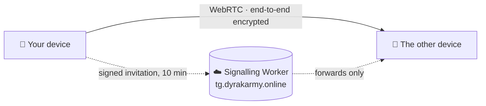

The server (a Cloudflare Worker) sees the short signed invitations of `/invite`, and in a demo room only its number and ciphertext. It cannot forge them and never sees messages, photos or calls. The Worker writes no logs (observability is off, no `console` calls in the code). The Cloudflare platform itself, like any host, still sees IP addresses and request URLs; details in [SECURITY.md](SECURITY.md). Local mode (QR) uses no server at all.

Signalling is separate from WebRTC (`src/signaling/`, interface `ISignalingProvider`):

- **Local** (`OfflineSignalingProvider`): the invitation is signed text shown as a QR code. No network requests.
- **Demo** (`PakeSignalingProvider` over `WebSocketSignalingProvider`): a room on the Worker with a 5-character number and 3 words that stay on the devices. Both sides run CPace with the words, confirm the key, and only then send the invitation, encrypted (XChaCha20-Poly1305). A wrong word fails the pairing; a room is never reused. Old clients with 10-character rooms are still accepted. Details: [docs/DEMO-SIGNALING.md](docs/DEMO-SIGNALING.md).

## 🎬 Tutorial: 7 ways to connect

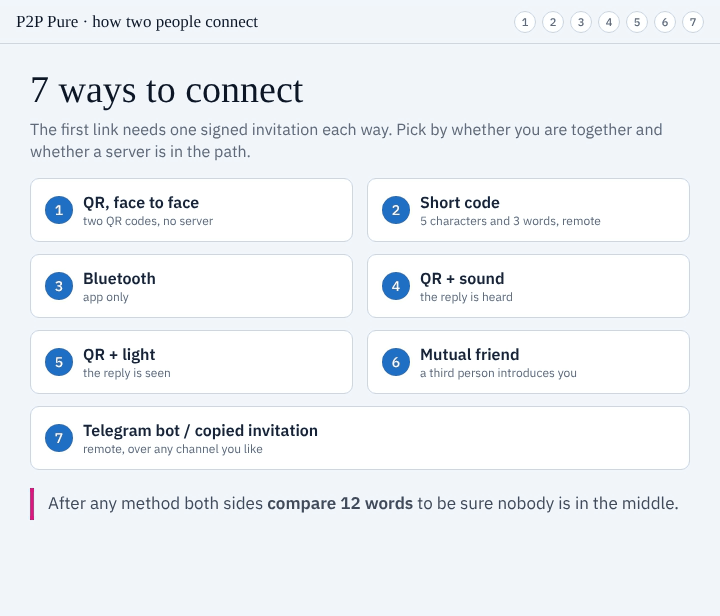

**A video for every method** (about 27 seconds, no sound; click the picture). In Bulgarian: [above](#-урок-7-начина-да-се-свържете).

<table>
<tr><td align="center"><a href="docs/public/assets/tutorial-qr-en.mp4">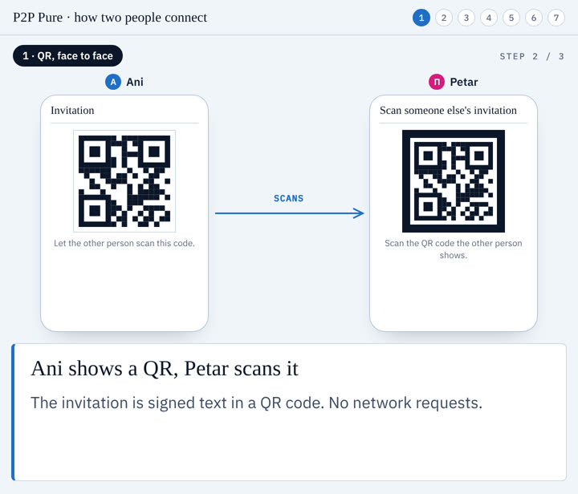</a><br><b>1. QR, face to face</b></td><td align="center"><a href="docs/public/assets/tutorial-short-code-en.mp4">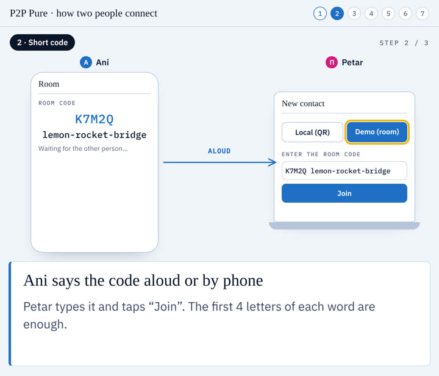</a><br><b>2. Short code</b></td><td align="center"><a href="docs/public/assets/tutorial-bluetooth-en.mp4">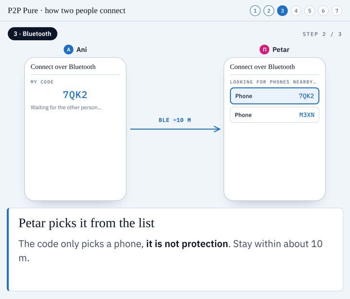</a><br><b>3. Bluetooth</b></td><td align="center"><a href="docs/public/assets/tutorial-sound-en.mp4">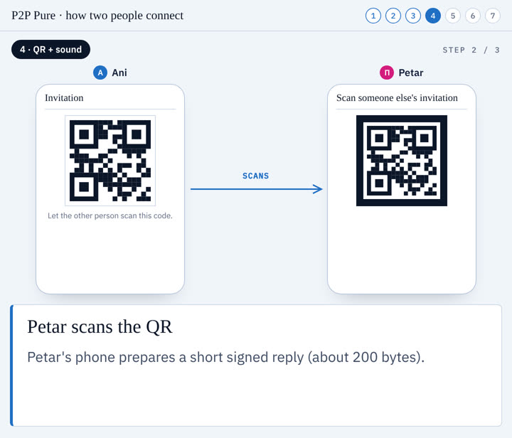</a><br><b>4. QR + sound</b></td></tr>
<tr><td align="center"><a href="docs/public/assets/tutorial-light-en.mp4">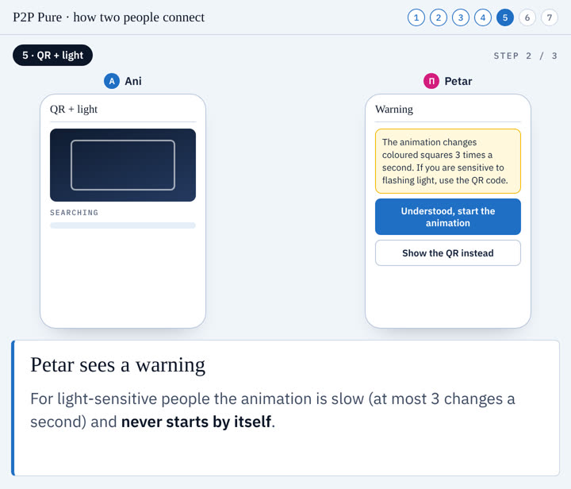</a><br><b>5. QR + light</b></td><td align="center"><a href="docs/public/assets/tutorial-introduction-en.mp4">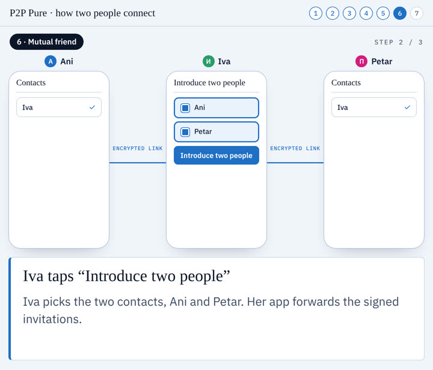</a><br><b>6. Mutual friend</b></td><td align="center"><a href="docs/public/assets/tutorial-telegram-en.mp4">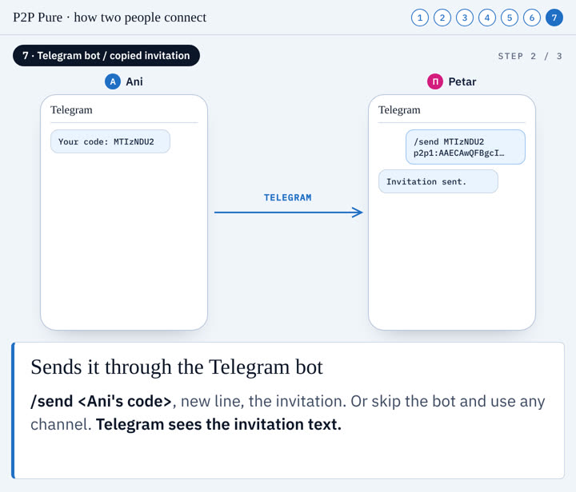</a><br><b>7. Telegram bot</b></td></tr>
</table>


1. **QR, face to face.** "Local (QR)": one shows a QR, the other scans it and shows a QR back. No server.
2. **Short code.** "Demo (room)": a code of 5 characters and 3 words, said aloud. The server sees only the room number.
3. **Bluetooth.** App only: one phone shows a 4-character code, the other picks it from the list.
4. **QR + sound.** QR one way; the reply comes back as sound (about 15 seconds, needs a microphone).
5. **QR + light.** QR one way; the reply is read by the camera as a colour animation (3 to 8 seconds), after a warning for light-sensitive people.
6. **Mutual friend.** They pick two of their contacts with "Introduce two people"; both accept. All three must be connected at the same time.
7. **Telegram bot / copied invitation.** The invitation (`p2p1:…`) is sent through the bot or any channel you like.

After any method, compare the **12 words** over another channel and tap "The words match". Comparison of the methods, security and platforms: [docs/CONNECTING.md](docs/CONNECTING.md). The animation is built with `node scripts/docs/tutorial-connect-gif.mjs`, the videos with `MODE=video node scripts/docs/tutorial-connect-gif.mjs`.

### Ani and Petar, end to end


1. **Profile.** Each person creates a profile on their phone with a passkey or a password and writes down the 12 words.
2. **Mode.** They pick "Local (QR)" when together, or "Demo (room)" when far apart. There are other ways too: Bluetooth, QR + sound, QR + light, a mutual friend ([docs/CONNECTING.md](docs/CONNECTING.md)).
3. **Invitation.** Ani taps "Show my invitation". Petar scans the QR code or types the short code.
4. **Demo room.** From a distance: Ani opens a room and tells Petar the code (5 characters and 3 words) over the phone; Petar types it and taps "Join".
5. **Verification words.** They compare the 12 words out loud or on video and tap "The words match".
6. **Chat.** They write, send photos and location.
7. **Call.** They call with audio or video.
8. **Group.** Ani creates a group of up to 9 people, gives it a name and a photo, and invites people.
9. **Everywhere.** It runs in the phone browser, on a computer and as a Windows and Linux app.

> ⚠️ The connection is direct, with no relay. Some mobile networks block direct connections. If it does not connect, use one Wi‑Fi network for the first pairing.

## 🚀 How to try it

| Way | For whom | What you need |
|---|---|---|
| **The site** [dyrakarmy.online/en/](https://dyrakarmy.online/en/) | Information and every download behind one button that fits your device | Just a browser. In 8 languages, always online (GitHub Pages), updated on every change to `main` and every release ([docs/SITE.md](docs/SITE.md)). |
| **The online version** [dyrakarmy.online/app/](https://dyrakarmy.online/app/) | The messenger right in the browser, on phone or computer | Just a browser. |
| **Windows** | A Windows 10/11 computer | [Releases](https://github.com/biramentv-ux/p2p-pure-releases/releases) → `P2P-Messenger-Setup-x64.exe` |
| **Linux** | A Linux computer (x86_64) | [Releases](https://github.com/biramentv-ux/p2p-pure-releases/releases) → `.deb`, `.rpm`, `AppImage`, `.flatpak` or `install.sh` |
| **Android** | An Android 7+ phone | [Releases](https://github.com/biramentv-ux/p2p-pure-releases/releases) → `P2P-Messenger-…-android.apk`, open it on the phone ([docs/ANDROID-APK.md](docs/ANDROID-APK.md)) |
| **A local copy** | Development, or when the site is down | Git and Node.js, see below. |

## 💻 Running locally, step by step

### 1. What you need (once)

| Program | Version | Windows | macOS | Linux (Debian/Ubuntu) |
|---|---|---|---|---|
| Git | any | `winget install --id Git.Git` | `xcode-select --install` | `sudo apt install git` |
| Node.js | 22.12 or newer (or 20.19+) | `winget install --id OpenJS.NodeJS.LTS` | `brew install node@22` | from [nodejs.org](https://nodejs.org) or `nvm install 22` |

After installing, **close and reopen the terminal**, then check:

```bash
git --version
node --version     # must be v22.12.0 or newer
npm --version
```

On Windows use **PowerShell** or **Windows Terminal**. If PowerShell refuses to run `npm` because of the "execution policy", run once: `Set-ExecutionPolicy -Scope CurrentUser RemoteSigned`.

### 2. Get the code

```bash
git clone https://github.com/biramentv-ux/p2p-pure.git
cd p2p-pure
```

This creates the folder `p2p-pure`. Run every next command from it.

### 3. Install the dependencies

```bash
npm ci
```

`npm ci` installs exactly the versions in `package-lock.json` (1–3 minutes the first time). Nothing is sent anywhere except the package downloads.

### 4. Start the app

```bash
npm run dev
```

Open **http://localhost:5173** in Chrome, Edge, Firefox or Safari. Code changes show up immediately. Stop with `Ctrl+C`.

To see exactly what gets published (with the service worker and offline mode):

```bash
npm run build      # type check and build into dist/
npm run preview    # http://localhost:4173
```

### 5. Try it as two people on one computer

Open the app in **two separate browser profiles** (for example a normal and a private window, or Chrome and Edge). Each profile is a separate person with their own keys. Connect them with a QR code (show it on screen and scan it with the camera) or with a demo room.

### 6. Problems and fixes

| Problem | Fix |
|---|---|
| `npm ci` complains about the Node version | Update Node.js to 22.12+ and open a new terminal. |
| `Port 5173 is already in use` | Another process uses the port. Close it or run `npm run dev -- --port 5174`. |
| The passkey button does nothing | Passkeys need `localhost` or https. Open it through `localhost`, not an IP address. |
| The camera does not start | Allow the camera in the browser (the icon left of the address). It also needs `localhost` or https. |
| It does not connect | Both sides must be online at the same time. Some networks block direct connections; try one Wi‑Fi network. |
| The demo room fails | The signalling Worker must be deployed with demo rooms (see [docs/DEMO-SIGNALING.md](docs/DEMO-SIGNALING.md)). Local mode always works. |

## 📱 Running it straight from a phone

### Option A: from the online version (no computer)

1. Open **https://dyrakarmy.online/app/** in Chrome (Android) or Safari (iPhone).
2. Add it as an app:
   - **Android, Chrome:** menu ⋮ → **Add to Home screen / Install app**.
   - **iPhone, Safari:** the Share button → **Add to Home Screen**.
3. Open it from the icon. It runs full screen and works offline for the parts already loaded.

### Option B: your local copy on the phone

On the computer, in the project folder:

```bash
npm run phone
```

The command builds the app, serves it on the computer and shows:

- **an address on the same Wi‑Fi** (`http://192.168.x.x:4173`). Enough to look at the screens, but a phone gives no camera, passkey or calls to a page without https.
- **a temporary https address and a QR code** in the terminal, when `cloudflared` is installed. Scan the code with the phone camera and everything works.

`cloudflared` is installed once and **needs no account**:

```bash
winget install --id Cloudflare.cloudflared    # Windows
brew install cloudflared                      # macOS
```

The temporary address (`https://….trycloudflare.com`) changes every run and works while the terminal is open. A passkey belongs to its address, so a profile made there is for testing. For everyday use, take Option A or the Windows app.

### Option C: the native app (Android/iOS, for developers)

```bash
npm run build
npx cap add android      # or ios, once
npm run mobile:sync
npx cap sync
npx cap open android     # opens Android Studio; or ios for Xcode
```

You need Android Studio or Xcode. Before release: the SHA-256 fingerprint in `assetlinks.json`, the Apple Team ID in the AASA file, and a permission test on a real device.

## 🪟 Windows

Download from [Releases](https://github.com/biramentv-ux/p2p-pure-releases/releases):

- `P2P-Messenger-Setup-x64.exe`: an installer, no admin rights needed;
- `P2P-Messenger-portable-x64.zip`: no install.

The package is not signed yet: on first start choose **More info → Run anyway**. With winget, once accepted in the official repository: `winget install DyrakArmy.P2PMessenger`. Details: [docs/WINDOWS.md](docs/WINDOWS.md).

> In the Windows app, unlocking with a passkey after a restart may not work (WebView2 does not return the PRF secret). Use a password then; after that you can turn on Windows Hello unlock (face, fingerprint or PIN), see docs/WINDOWS.md. The password and the 12 words stay. CI runners have no Windows Hello, so CI only checks that the method stays hidden and the commands are locked down.

## 🐧 Linux

Download the `.deb` (Debian, Ubuntu), `.rpm` (Fedora, openSUSE) or `AppImage` from [Releases](https://github.com/biramentv-ux/p2p-pure-releases/releases), or run `install.sh`: it picks the package, **verifies the checksum** and installs.

```bash
bash install.sh              # or: bash install.sh --appimage  (just for you, no root)
```

GPG signing and an `apt`/`dnf` repository (`bash install.sh --add-repo`) switch on once the owner adds a key ([docs/SIGNING.md](docs/SIGNING.md)); until then the package is unsigned. The Linux app ships its own Chromium (Electron), because the WebKitGTK of Debian and Ubuntu has no WebRTC. There are no passkeys: the app unlocks with a password. On Ubuntu 24.04 use the `.deb`, not the AppImage. Details: [docs/LINUX.md](docs/LINUX.md).

## 🧩 Chrome extension

1. `npm run extension:pack` → `dist/extension/p2p-messenger-quick-launch-1.0.0.zip`.
2. `chrome://extensions` → **Developer mode** → **Load unpacked** → the `extension/` folder.
3. Shortcut: `Ctrl+Shift+M` (`Command+Shift+M` on Mac).

The extension collects no data; it only opens the app.

## 🧪 Experiments (off by default)

| | What it is | Where | Document |
|---|---|---|---|
| **P4 Native transport** | When WebRTC can't get through (restricted↔symmetric, symmetric↔symmetric NAT), the app's own UDP sockets: a port from the router (PCP, NAT-PMP, UPnP-IGD) and "birthday" punching with 256 sockets. ChaCha20-Poly1305 per datagram, the same Double Ratchet on top. | Electron, Tauri (`--features native-transport`), Android | [ADR-007](.10x/adrs/007-p4-native-transport.md), [PROTOCOL §9a](docs/PROTOCOL.md) |
| **P5 Mesh** | Packets over Bluetooth and Wi-Fi Aware from phone to phone, TTL ≤ 7, store and forward, rotating ids. Short texts over LoRa (Meshtastic). No new crypto format. | Core and Android plugin; no screen yet | [ADR-008](.10x/adrs/008-p5-mesh.md), [PROTOCOL §9c](docs/PROTOCOL.md) |
| **P6 Tor only** | Arti: a link only between two onion services, no IP address in the invitation. | Tauri (`--features tor-transport`); Android APK from the "Android APK with Tor" workflow | [docs/TOR.md](docs/TOR.md), [ADR-009](.10x/adrs/009-p6-tor-onion-only.md), [ADR-013](.10x/adrs/013-p6-tor-android.md) |
| **P3 Background link** | No push server: a foreground service keeps the links up with the screen off and new messages become system notifications. Uses battery. UnifiedPush is not used (it needs a server). | Android | [docs/NOTIFICATIONS.md](docs/NOTIFICATIONS.md), [ADR-012](.10x/adrs/012-p3-android-keep-alive.md) |
| **P7 New key of someone you know** | Whoever lost their 12 words gets signatures from mutual contacts who checked the new key; others count only signatures from contacts they verified themselves. No log, no server. | Everywhere (chat → Cryptography) | [docs/KEY-CONTINUITY.md](docs/KEY-CONTINUITY.md), [ADR-011](.10x/adrs/011-p7-key-continuity.md) |
| **N8 NAT lab** | Linux namespaces with cone, restricted and symmetric NAT, packet loss, a local STUN and two browsers; a phone farm; the error says why it didn't connect. | `sudo npm run test:natlab`, `npm run farm` | [docs/NAT-LAB.md](docs/NAT-LAB.md), [docs/DEVICE-FARM.md](docs/DEVICE-FARM.md) |
| **N9 Fuzz tests** | fast-check on every parser: no input throws anything but the defined errors. | `npm run test:fuzz` | [ADR-006](.10x/adrs/006-n8-nat-lab-and-fuzzing.md) |

Not verified yet: the Android and Windows shells of the native transport, the mesh radio and the background link on real phones; the APK with Tor on a phone (Tor against the real network now passes in CI); the IPv6 lab scenarios (they run in CI only).

## ⚠️ Trade-offs we accept

- **Public STUN servers only by default.** The app ships no TURN relay, so strict NATs or corporate firewalls may block the connection. Optionally you can enter **your own** `turn:`/`turns:` server (Identity tab, "own TURN relay"). A relay sees metadata (IP addresses, timing, sizes) but not content, because everything is end-to-end encrypted. Its credentials are stored only encrypted on the device ([SECURITY.md](SECURITY.md)).
- **One server with a narrow role.** The Worker keeps temporary invitations (up to 10 minutes, deleted on first fetch) and forwards demo-room frames without storing them. It writes no logs, and the IP used for rate limiting is hashed. Cloudflare as a platform sees IP addresses and request URLs ([SECURITY.md](SECURITY.md)). It never sees messages.
- **Deleting a chat** reaches the other person only if they are online.
- **Groups:** a pending candidate's invitation is not kept across a reload; a member removed while offline learns about it on the next connection.
- **The safety code (v3)** is 12 words = 132 bits (previously 6 words, 66 bits). Contacts already verified stay verified; new comparisons use 12 words.
- **Bluetooth pairing** (Android and iOS, own Capacitor plugin, [docs/BLUETOOTH.md](docs/BLUETOOTH.md)) has a button on the "Connect" screen only in the native app. It has not been tried on real phones; the manual test plan is in the document.
- **CPace (PAKE)** is checked against the official test vectors of draft-irtf-cfrg-cpace-21, but the implementation is not audited. The safety code (the 12 words) remains the main protection: always compare it, whichever way you connected.
- **The cryptography is not independently audited.** The Double Ratchet is our own implementation of Signal's public specification, not the official `libsignal`.

## 🗂️ Structure

```
src/
  identity/         passkey, password, did:key, BIP39
  signaling/        local (QR) and demo (WebSocket) providers
  p2p/              WebRTC channel, session, Double Ratchet, photos
  group/            groups: rules, signed state, links, encrypted storage
  call/             calls
  history/          encrypted history (IndexedDB)
  contacts/         contacts and verification (encrypted, keyed by HMAC(DID))
  notify/           notifications and synthesized sounds
  transfer/         moving the profile to a new device
  i18n/             the app's languages (bg, en, ru, de, es, pt)
  ui/               screens and components
  post.css          the "Sealed Post" theme (light and dark)
src-tauri/          the Windows app (Tauri 2)
electron/           the Linux app (Electron: .deb, .rpm, AppImage)
extension/          Chrome extension (MV3)
site/               the dyrakarmy.online website (8 languages); the messenger lives at /app/
worker/             Cloudflare Worker: invitations, demo rooms (Durable Object), Telegram
scripts/            phone (phone.mjs), Windows, winget, Linux (install.sh), mobile files
tests/              unit (Vitest), e2e and a11y (Playwright + Chromium), Windows (WebView2), Linux (Electron)
docs/               guides: ways to connect, Windows, Linux, demo signalling, Bluetooth, groups, Telegram bot
```

## 🧪 Tests

| Command | What it checks |
|---|---|
| `npm test` | Unit tests: 1200+ tests |
| `npm run lint` | oxlint |
| `npm run test:e2e` | Two people in a browser: QR, 12 verification words, encrypted exchange, replay protection |
| `npm run test:ui` | The whole interface: profile, chat, photos, demo room, calls, groups, dark mode (29 checks) |
| `npm run test:demo` | Demo room through a local relay (8 checks) |
| `npm run test:pages` | The GitHub Pages build under the `/p2p-pure/` sub-path (6 checks) |
| `npm run test:files` | Files between two people: GIF, 100 MB byte for byte, resume after a drop, limit, decline, HTML as a download |
| `npm run test:a11y` / `test:a11y:dark` | axe-core (WCAG 2.2 AA) on every screen, in both languages |
| `npm run test:fuzz` | fast-check on the parsers (`FUZZ_RUNS=2000` for a longer run) |
| `sudo npm run test:natlab` | The NAT lab: WebRTC and the native transport through real NATs on Linux |
| `npm run test:call` | Audio and video call |
| `npm run test:extension-browser` | The extension in Chromium |

## 🚀 Release and CI

| Workflow | When | What it does |
|---|---|---|
| `web.yml` | push and PR to `main` | Secret scan, lint, unit tests, build, extension, `npm audit` |
| `gradle.yml` | push and PR to `main` | Android build with Capacitor |
| `pages.yml` | push to `main`, after a Linux release | Publishes the online version to GitHub Pages (and the signed Linux repository under `/linux/`, if any) |
| `windows-desktop.yml` | manual or a `desktop-v*` tag | Installer, portable, WebView2 test, winget, Release |
| `linux-desktop.yml` | manual or a `desktop-v*` tag | `.deb`, `.rpm`, AppImage, Flatpak, an install test, Release |
| `android-apk.yml` | manual or an `android-v*` tag | Signed APK with checksums, Release |
| `ios-testflight.yml` | a change in `ios/`, or manual | Compiles on macOS; with the Apple secrets also uploads to TestFlight ([docs/IOS.md](docs/IOS.md)) |
| `release-sbom.yml` | a published release | SBOM (CycloneDX), checksums and a Sigstore signature on the release |
| `public-docs.yml` | a change to the public documents | Copies the README, license, SECURITY and guides to the public `p2p-pure-releases` repository |
| `worker-deploy.yml` | a change in `worker/`, or manual | Tests and deploys the signalling Worker to Cloudflare |

**The signalling Worker** (short codes and demo rooms) is deployed from GitHub once you add the `CLOUDFLARE_API_TOKEN` and `CLOUDFLARE_ACCOUNT_ID` secrets. Steps: [docs/DEMO-SIGNALING.md](docs/DEMO-SIGNALING.md).

**The site and the online version** (`dyrakarmy.online`, the messenger at `/app/`) are published automatically from `main` to GitHub Pages of the public `p2p-pure-releases` repository, so they run without the owner's computer. The code is private; releases and the site are public: [docs/PRIVATE-REPO.md](docs/PRIVATE-REPO.md). A passkey belongs to its address; on another address, bring the profile over with the 12 words.

## 🌍 Language

The app speaks 6 languages: Bulgarian (default), English, Русский, Deutsch, Español and Português (Brasil). It follows the browser and can be changed in the app; the choice is remembered. The key is the Bulgarian text; translations are in `src/i18n/<language>.ts`.

The site speaks 8 (adding Français and 简体中文), each at its own address: `/`, `/en/`, `/es/`, `/pt/`, `/fr/`, `/de/`, `/ru/`, `/zh/` ([docs/SITE.md](docs/SITE.md)). The translations are machine-made and not yet reviewed by native speakers.

## 🔒 Security

Report a suspected vulnerability privately: **Security → Report a vulnerability** on GitHub, not in a public issue.

## 📄 License

See [LICENSE](LICENSE).

---

<div align="center">

Made with 🔐, 🌍 and a lot of care · Направено с 🔐, 🌍 и много внимание

</div>
