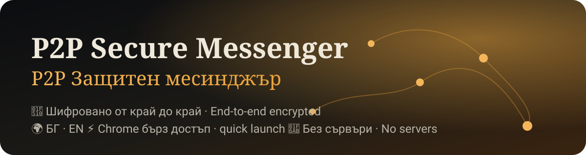
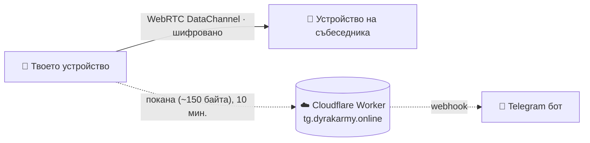
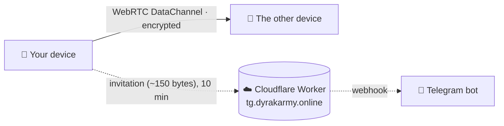

<div align="center">



# 🔐 P2P Secure Messenger · P2P Защитен месинджър

**Личен, децентрализиран, шифрован от край до край.**
**A private, decentralised, end-to-end encrypted messenger.**

[](#-тестове--tests)
[](#-тестове--tests)
[](#-инсталация--installation)
[](#-language)

### 🌍 Language / Език

[🇧🇬 **Български**](#-български) · [🇬🇧 **English**](#-english)

</div>

---

<a id="-български"></a>

# 🇧🇬 Български

> Съобщенията се шифроват на устройството и се пращат **директно** между двама души през WebRTC.
> Няма централен сървър, който пази съобщения, акаунти или телефонни номера.

*Състояние към 21 октомври 2026: работеща PWA за уеб, Capacitor проект за Android и iOS, Chrome разширение за бърз достъп, двуезичен интерфейс (БГ и EN) и тестове на всички нива. Native билдовете не са тествани на физически устройства.*

## ✨ Какво може

| | Функция | Какво означава |
|---|---|---|
| 🪪 | **Идентичност без регистрация** | Passkey на устройството → `did:key` (`z6Mk…`). Без имейл, телефон или SMS. |
| 🔑 | **Възстановяване с 12 думи** | BIP39. Записваш ги веднъж и ги ползваш на нов телефон. |
| 📷 | **Контакт с QR код или кратък код** | Кратък код от 10 символа, валиден 10 минути и за еднократна употреба. |
| 🔢 | **Проверка на събеседника** | Двамата виждат един и същи код от 6 думи, изчислен от публичните X25519 ключове на двамата (версия v2). Сравнявате го лично или по видео. |
| 🛰️ | **Два режима на сигнализация** | Локален режим (по подразбиране): QR или текст, без мрежови заявки. Демо режим: WebSocket стая в сигналния Worker, за по-лесно начало. |
| 👥 | **Групов чат (бета)** | До 9 участника. Създателят е админ: добавя, премахва, сменя името, снимката и криптографския метод. Всеки участник е свързан с всеки друг. |
| 💬 | **Шифровани чатове** | Double Ratchet подход. Историята се пази в IndexedDB, шифрована с AES-GCM. |
| 🖼️ | **Снимки, локация, изтриване** | Изтриване на чат от двете страни. Локацията се праща само при твое натискане. |
| 📞 | **Аудио и видео разговори** | WebRTC, медията е DTLS-SRTP. |
| 🌍 | **Два езика** | Български (по подразбиране) и English. Смяната е в горната лента и се помни. |
| ⚡ | **Бърз достъп от браузъра** | Разширение за Chrome: клавишна комбинация `Ctrl+Shift+M` отваря месинджъра. |

## 🧭 Как работи



Сървърът (Worker) вижда само кратки покани и не може да прочете нито една. Съобщенията, снимките и разговорите не минават през него.

**Сигнализацията е отделена от WebRTC.** `src/signaling/` дава общ интерфейс `ISignalingProvider`. Двата режима са два провайдъра:

- **Локален (офлайн)** — `OfflineSignalingProvider`. Поканата е подписан низ, който се показва като QR или текст. Няма мрежови заявки.
- **Демо (WebSocket)** — `WebSocketSignalingProvider`. Единият устройство отваря стая и показва 10-символен код; другият се присъединява с кода. Worker-ът пренася кадрите между двамата и не ги чете. Подписаната покана се проверява на клиента.

Ядрото на приложението работи без Worker-а. Демо режимът е допълнителен канал.

> **В момента:** превключвателят Демо/Локален в интерфейса още не е готов, а Worker-ът трябва да се публикува с новата миграция за Durable Object (`SignalRoom`).

## 🎬 Урок за деца: как двама се свързват от разстояние


Ани и Петър са далеч един от друг, всеки със собствен телефон. Ето как се свързват:

1. Всеки създава своя идентичност на телефона си. Не трябва телефонен номер или имейл.
2. Ани натиска „Покажи моята покана“ и показва QR код или кратък код (10 знака, важи 10 минути и работи само веднъж).
3. Петър натиска „Сканирай чужда покана“ и сканира QR кода или въвежда краткия код.
4. Петър показва „Отговор“, а Ани го сканира с „Сканирай отговора“.
5. И двамата виждат едни и същи 6 думи. Сравняват ги лично или по видео и натискат „Думите съвпадат“.
6. Пишат си. Съобщенията са шифровани и минават директно между телефоните.

> ⚠️ Връзката е директна, без посредник. Не винаги минава: някои мобилни мрежи блокират директните връзки. Ако не се свърже, опитайте с една Wi‑Fi мрежа за първото сдвояване.

## ⚠️ Ограничения, които приемаме

- **Само публични STUN сървъри** (`stun.l.google.com`). Без TURN релей, затова строги NAT или корпоративни firewall-и може да блокират връзката.
- **Един сървър с ограничена роля.** Cloudflare Worker-ът пази временни покани и обработва webhook-а на Telegram бота.
- **Изтриването на чат** стига до другия човек само ако той е онлайн. Няма сървър, който да пази историята.
- **Публичният адрес `dyrakarmy.online`** се обслужва през Cloudflare Tunnel от компютъра на собственика. Достъпността му зависи от този компютър.
- **Групите са само в паметта.** При презареждане на страницата групата се губи, а съобщенията от групата не се записват в историята.
- **Снимката на групата** се сверява по хеш; самият файл още не се предава.
- **Безопасният код v2** е различен от v1. И двете устройства трябва да са на една версия, за да сравнят кодовете.

## 🛠️ Инсталация и стартиране

Нужни са Node.js LTS и npm.

```bash
npm ci
npm run dev              # разработка на http://localhost:5173
npm run build            # tsc + vite build, генерира PWA service worker
npx vite preview --host 127.0.0.1 --port 4173
```

Адресът на сигналния Worker е по подразбиране `https://tg.dyrakarmy.online`. Може да се смени при билд с `VITE_INVITE_API`.

### 🧩 Chrome разширение (бърз достъп)

1. `npm run extension:pack` → файлът е в `dist/extension/p2p-messenger-quick-launch-1.0.0.zip`.
2. Разархивирай го или ползвай папката `extension/` директно.
3. В Chrome отвори `chrome://extensions`, включи **Developer mode** и натисни **Load unpacked**.
4. Избери папката. Клавишната комбинация е `Ctrl+Shift+M` (на Mac `Command+Shift+M`).

Разширението не събира данни и няма собствен сървър. Само отваря приложението. Публикуване в Chrome Web Store още не е направено.

### 🪟 Windows (Tauri 2)

Свали от [Releases](https://github.com/biramentv-ux/p2p-pure/releases) `P2P-Messenger-Setup-x64.exe` (инсталатор, без администраторски права) или `P2P-Messenger-portable-x64.zip` (без инсталиране). Цялото приложение е вътре в пакета и не зависи от сайта. Пакетът още не е подписан: при първо стартиране натисни **More info → Run anyway**. Подробности: [docs/WINDOWS.md](docs/WINDOWS.md).

### 📲 Android и iOS (Capacitor 8)

```bash
npm run build
npx cap add android      # или ios, веднъж
npm run mobile:sync
npx cap sync
npx cap open android     # или ios
```

- `appId`: `bg.p2pmessenger.app`
- Android passkey през Credential Manager (`PasskeyBridgePlugin.java`). `rpId` се подава през `VITE_PASSKEY_RP_ID`.
- Разрешения: камера, микрофон, точна локация. Манифестите се генерират от `npm run mobile:sync`.

**Преди публикуване остава:** да се замени SHA-256 отпечатъкът в `assetlinks.json` и Apple Team ID в AASA файла, и да се тестват разрешенията на реални устройства.
**Ограничение на средата за разработка:** Android SDK и Xcode не са инсталирани тук. Native билдовете са проверени само в CI (Android).

## 🌍 Език

Интерфейсът е на български по подразбиране, а на английски се показва, ако браузърът е на английски. Избраният език се запазва в браузъра.

Всички UI низове са в `src/i18n/en.ts`. Ключът е българският текст, така че липсващ превод показва български, а не празно място. Тестовете пазят пълното покритие, съвпадението на placeholder-ите и отсъствието на кирилица в английските стойности.

## 🗂️ Структура

```
src/
  i18n/             двуезичен слой: ядро, контекст, речник (bg/en)
  identity/         passkey, did:key, BIP39
  p2p/              WebRTC канал, сесия, снимки, управляващи съобщения
  signaling/        провайдъри за сигнализация: локален (QR) и демо (WebSocket)
  group/            групов чат: правила, подписани снимки, mesh връзки
  call/             контролер за разговори
  history/          шифрована история (IndexedDB)
  contacts/         контакти и потвърждение
  platform/mobile/  Capacitor мост и passkey през Android Credential Manager
  ui/               екрани и компоненти
  App.css, index.css  дизайн система (токени, светла и тъмна тема)
extension/          Chrome разширение (MV3): popup, service worker, locales bg/en
worker/             Cloudflare Worker: покани, стаи за демо сигнализация (Durable Object), Telegram webhook, cron
native-overlays/    Java код за Android и настройки
scripts/            синхронизация на мобилните файлове, Windows скриптове, пакетиране на разширението
tests/              unit (Vitest), mock Worker, e2e (Playwright + Chromium), a11y (axe-core)
```

## 🧪 Тестове

| Команда | Какво проверява |
|---|---|
| `npm test` | Unit тестове: 27 файла, 255 теста (Vitest, fake-indexeddb) |
| `npm run lint` | oxlint |
| `npm run test:i18n` | Английският пакет в браузър: превключване, запомняне, без български текст в EN |
| `npm run test:a11y` | axe-core (WCAG 2.2 A/AA) на всички екрани, на двата езика, в светла и тъмна тема |
| `npm run test:extension-browser` | Разширението в Chromium: popup на двата езика, отваряне и повторно използване на раздела |
| `npm run test:mock` | API срещу mock Worker (51 проверки) |
| `npm run test:mock-ui` | Ръкостискане с кратък код между две страници (9 проверки) |
| `npm run test:chat` | Локация, отказан достъп, изтриване на чат (11 проверки) |
| `npm run test:call` | Аудио и видео разговор между две браузърни сесии (13 проверки) |
| `npm run test:mobile` | Overlay файловете и rpId за native среда |
| `npm run mobile:check` | Готовност на Android и iOS проектите |

e2e тестовете минават с локал `bg-BG`, защото проверяват българските етикети. Тестът `tests/e2e/ui.mjs` е нестабилен и не се пуска с retry.

## 🚀 Публикуване и CI

Workflow-ът `Java CI with Gradle` (`.github/workflows/gradle.yml`) се изпълнява при всеки push и PR към `main`:

1. Инсталира npm зависимостите и билдва уеб приложението.
2. Пуска `npx cap sync android`, който генерира файловете, нужни на Gradle.
3. Билдва Android проекта с JDK 21 (`./gradlew build`, включително lint).
4. Изпраща dependency graph.

Към 21 октомври 2026 и двата job-а минават на `main`. Ако билдът падне, в резултата от run-а се виждат последните редове от Gradle изхода и грешките от lint.

**Публичният сайт** се обновява от компютъра на собственика: `scripts/windows/deploy.ps1` дърпа `main`, билдва `dist/` и го пуска през тунела. Виж `docs/telegram-bot-guide.md` за Worker-а и бота.

## 🔒 Сигурност

Виж `SECURITY.md`. Подозрителна уязвимост съобщавайте на собственика на репото, не публично в issue.

## 📄 Лиценз

Виж `LICENSE`.

---

<a id="-english"></a>

# 🇬🇧 English

> Messages are encrypted on the device and sent **directly** between two people over WebRTC.
> There is no central server that stores messages, accounts or phone numbers.

*Status as of 21 October 2026: a working PWA for the web, a Capacitor project for Android and iOS, a Chrome quick-launch extension, a bilingual interface (BG and EN), and tests at every level. The native builds have not been tested on physical devices.*

## ✨ What it does

| | Feature | What it means |
|---|---|---|
| 🪪 | **Identity without sign-up** | A passkey on the device → `did:key` (`z6Mk…`). No email, phone or SMS. |
| 🔑 | **Recovery with 12 words** | BIP39. Write them down once and use them on a new phone. |
| 📷 | **Contact by QR code or short code** | A 10-character code, valid for 10 minutes and single-use. |
| 🔢 | **Verify the other person** | Both sides see the same 6-word code, computed from both sides' public X25519 keys (version v2). Compare it in person or on video. |
| 🛰️ | **Two signalling modes** | Local mode (default): QR or text, no network requests. Demo mode: a WebSocket room on the signalling Worker, for an easier start. |
| 👥 | **Group chat (beta)** | Up to 9 members. The creator is admin: adds and removes members, sets the name, the photo and the encryption method. Every member is linked to every other member. |
| 💬 | **Encrypted chats** | Double Ratchet approach. History is kept in IndexedDB, encrypted with AES-GCM. |
| 🖼️ | **Photos, location, deletion** | Delete a chat on both sides. Location is sent only when you tap to send it. |
| 📞 | **Audio and video calls** | WebRTC; media is protected with DTLS-SRTP. |
| 🌍 | **Two languages** | Bulgarian (default) and English. Switch in the top bar; the choice is remembered. |
| ⚡ | **Fast access from the browser** | Chrome extension: the shortcut `Ctrl+Shift+M` opens the messenger. |

## 🧭 How it works



The server (Worker) only sees short invitations and cannot read any of them. Messages, photos and calls never pass through it.

**Signalling is separate from WebRTC.** `src/signaling/` provides one interface, `ISignalingProvider`. The two modes are two providers:

- **Local (offline)** — `OfflineSignalingProvider`. The invitation is a signed string, shown as a QR code or text. No network requests.
- **Demo (WebSocket)** — `WebSocketSignalingProvider`. One device opens a room and shows a 10-character code; the other joins with that code. The Worker forwards frames between the two and never reads them. The signed invitation is verified on the client.

The core app works without the Worker. Demo mode is an optional extra channel.

> **Status:** the Demo/Local switch in the interface is not ready yet, and the Worker must be deployed with the new Durable Object migration (`SignalRoom`).

## 🎬 Kid-friendly tutorial: connecting from a distance


Ani and Petar are far apart, each with their own phone. Here is how they connect:

1. Each person creates their identity on their phone. No phone number or email is needed.
2. Ani taps "Show my invitation" and shows a QR code or a short code (10 characters, valid for 10 minutes, works only once).
3. Petar taps "Scan someone else's invitation" and scans the QR code or types the short code.
4. Petar shows an "Answer", and Ani scans it with "Scan the answer".
5. Both see the same 6 words. They compare them in person or on a video call and tap "The words match".
6. They chat. Messages are encrypted and go directly between the phones.

> ⚠️ The connection is direct, with no relay. It does not always work: some mobile networks block direct connections. If it does not connect, try one Wi‑Fi network for the first pairing.

## ⚠️ Trade-offs we accept

- **Public STUN servers only** (`stun.l.google.com`). No TURN relay, so strict NATs and corporate firewalls may block the connection.
- **One server with a narrow role.** The Cloudflare Worker keeps temporary invitations and handles the Telegram bot webhook.
- **Deleting a chat** reaches the other person only if they are online. No server keeps the history.
- **The public address `dyrakarmy.online`** is served through a Cloudflare Tunnel from the owner's computer, so its availability depends on that computer.
- **Groups live in memory only.** Reloading the page loses the group, and group messages are not saved to history.
- **The group photo** is checked by hash; the file itself is not transferred yet.
- **Safety code v2** differs from v1. Both devices must run the same version to compare codes.

## 🛠️ Installation and running

You need Node.js LTS and npm.

```bash
npm ci
npm run dev              # development on http://localhost:5173
npm run build            # tsc + vite build, generates the PWA service worker
npx vite preview --host 127.0.0.1 --port 4173
```

The signalling Worker defaults to `https://tg.dyrakarmy.online`. Change it at build time with `VITE_INVITE_API`.

### 🧩 Chrome extension (quick launch)

1. Run `npm run extension:pack` → the file is `dist/extension/p2p-messenger-quick-launch-1.0.0.zip`.
2. Unzip it, or use the `extension/` folder directly.
3. In Chrome open `chrome://extensions`, turn on **Developer mode**, then click **Load unpacked**.
4. Pick the folder. The shortcut is `Ctrl+Shift+M` (`Command+Shift+M` on Mac).

The extension collects no data and has no server of its own; it only opens the app. It is not yet published in the Chrome Web Store.

### 🪟 Windows (Tauri 2)

Download `P2P-Messenger-Setup-x64.exe` (installer, no admin rights) or `P2P-Messenger-portable-x64.zip` (no install) from [Releases](https://github.com/biramentv-ux/p2p-pure/releases). The whole app is inside the package and does not depend on the website. The package is not signed yet: on first start choose **More info → Run anyway**. Details: [docs/WINDOWS.md](docs/WINDOWS.md).

### 📲 Android and iOS (Capacitor 8)

```bash
npm run build
npx cap add android      # or ios, once
npm run mobile:sync
npx cap sync
npx cap open android     # or ios
```

- `appId`: `bg.p2pmessenger.app`
- Android passkeys through Credential Manager (`PasskeyBridgePlugin.java`). `rpId` is passed via `VITE_PASSKEY_RP_ID`.
- Permissions: camera, microphone, precise location. The manifests are generated by `npm run mobile:sync`.

**Still to do before release:** replace the SHA-256 fingerprint in `assetlinks.json` and the Apple Team ID in the AASA file, and test permissions on real devices.
**Limit of this development environment:** the Android SDK and Xcode are not installed here. Native builds are verified only in CI (Android).

## 🌍 Language

The interface is Bulgarian by default and switches to English when the browser is in English. The choice is saved in the browser.

All UI strings are in `src/i18n/en.ts`. The key is the Bulgarian text, so a missing translation shows Bulgarian rather than an empty label. Tests check full coverage, placeholder matching, and that English values contain no Cyrillic.

## 🗂️ Structure

```
src/
  i18n/             two-language layer: core, context, dictionary (bg/en)
  identity/         passkey, did:key, BIP39
  p2p/              WebRTC channel, session, photos, control messages
  signaling/        signalling providers: local (QR) and demo (WebSocket)
  group/            group chat: rules, signed snapshots, mesh links
  call/             call controller
  history/          encrypted history (IndexedDB)
  contacts/         contacts and verification
  platform/mobile/  Capacitor bridge and Android Credential Manager passkeys
  ui/               screens and components
  App.css, index.css  design system (tokens, light and dark themes)
extension/          Chrome extension (MV3): popup, service worker, bg/en locales
worker/             Cloudflare Worker: invitations, demo signalling rooms (Durable Object), Telegram webhook, cron
native-overlays/    Android Java code and settings
scripts/            mobile file sync, Windows scripts, extension packaging
tests/              unit (Vitest), mock Worker, e2e (Playwright + Chromium), a11y (axe-core)
```

## 🧪 Tests

| Command | What it checks |
|---|---|
| `npm test` | Unit tests: 27 files, 255 tests (Vitest, fake-indexeddb) |
| `npm run lint` | oxlint |
| `npm run test:i18n` | The English package in a browser: switching, remembering, no Bulgarian text in EN |
| `npm run test:a11y` | axe-core (WCAG 2.2 A/AA) on every screen, in both languages, light and dark themes |
| `npm run test:extension-browser` | The extension in Chromium: popup in both languages, opening and reusing the tab |
| `npm run test:mock` | API against a mock Worker (51 checks) |
| `npm run test:mock-ui` | Short-code handshake between two pages (9 checks) |
| `npm run test:chat` | Location, refused access, chat deletion (11 checks) |
| `npm run test:call` | Audio and video call between two browser sessions (13 checks) |
| `npm run test:mobile` | Overlay files and rpId for the native environment |
| `npm run mobile:check` | Readiness of the Android and iOS projects |

The e2e tests run with the `bg-BG` locale because they check Bulgarian labels. `tests/e2e/ui.mjs` is flaky and is not retried.

## 🚀 Release and CI

The `Java CI with Gradle` workflow (`.github/workflows/gradle.yml`) runs on every push and pull request to `main`:

1. Installs npm dependencies and builds the web app.
2. Runs `npx cap sync android`, which generates the files Gradle needs.
3. Builds the Android project with JDK 21 (`./gradlew build`, including lint).
4. Submits the dependency graph.

As of 21 October 2026 both jobs pass on `main`. If the build fails, the run summary shows the last lines of the Gradle output and the lint errors.

**The public site** is updated from the owner's computer: `scripts/windows/deploy.ps1` pulls `main`, builds `dist/`, and serves it through the tunnel. See `docs/telegram-bot-guide.md` for the Worker and the bot.

## 🔒 Security

See `SECURITY.md`. Report a suspected vulnerability to the repository owner, not in a public issue.

## 📄 License

See `LICENSE`.

---

<div align="center">

Made with 🔐, 🌍 and a lot of care · Направено с 🔐, 🌍 и много внимание

</div>
