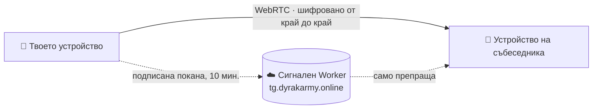
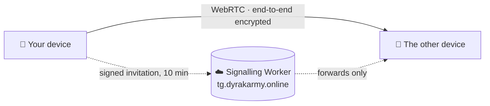

<div align="center">


# 🔐 P2P Secure Messenger · P2P Защитен месинджър

**Личен, децентрализиран, шифрован от край до край.**
**A private, decentralised, end-to-end encrypted messenger.**

[](#-тестове)
[](#-тестове)
[](#-как-да-го-пробвам)
[](#-език)

### 🌍 Language / Език

[🇧🇬 **Български**](#-български) · [🇬🇧 **English**](#-english)

</div>

---

<a id="-български"></a>

# 🇧🇬 Български

> Съобщенията се шифроват на устройството и се пращат **директно** между хората през WebRTC.
> Няма централен сървър, който пази съобщения, акаунти или телефонни номера.

*Състояние към 26 октомври 2026: работеща PWA за уеб и телефон, програми за Windows (инсталатор, portable и winget) и Linux (.deb, .rpm, AppImage), Capacitor проект за Android и iOS, разширение за Chrome, двуезичен интерфейс и тестове на всички нива. Native билдовете за Android и iOS не са тествани на физически устройства.*

## ✨ Какво може

| | Функция | Какво означава |
|---|---|---|
| 🪪 | **Профил без регистрация** | Passkey на устройството или парола → `did:key` (`z6Mk…`). Без имейл, телефон или SMS. |
| 🔑 | **Възстановяване с 12 думи** | BIP39. Записваш ги веднъж и ги ползваш на ново устройство. |
| 📷 | **Контакт с QR или кратък код** | Подписана покана. Краткият код е 10 знака, важи 10 минути и работи веднъж. |
| 🛰️ | **Демо стая** *(ново)* | Превключвател „Локален (QR) / Демо (стая)“. В демо режим единият отваря стая и праща кода, другият влиза с него. |
| 🔢 | **12 думи за проверка** | Двамата виждат едни и същи 12 думи (3 групи по 4), изчислени от публичните X25519 ключове (v3, 132 бита). Ако съвпадат, никой не стои по средата. |
| 💬 | **Шифровани чатове** | Double Ratchet. Историята и контактите се пазят в IndexedDB, шифровани с AES-GCM. |
| 📎 | **Файлове до 100 MB** *(ново)* | Всякакви файлове и видео, директно между устройствата. Получателят приема или отказва; файлове до 25 MB остават шифровани в историята. |
| 🖼️ | **Снимки, локация, изтриване** | Изтриване на чата и при двамата. Локацията се праща само при твое натискане. |
| 📞 | **Аудио и видео разговори** | По същата директна връзка, медията е DTLS-SRTP. |
| 👥 | **Групи до 9 души** *(обновено)* | Админ, име и снимка на групата. Файлове, снимки, видео до 50 MB и GIF от GIPHY. Новият член не вижда старата история; махането става и когато махнатият е офлайн. Всичко се пази шифровано. |
| 🪟 | **Windows** *(ново)* | Инсталатор без админ права, portable zip и `winget`. Цялото приложение е вътре. |
| 🐧 | **Linux** *(ново)* | `.deb`, `.rpm`, AppImage и `install.sh` с проверка на сумите. Цялото приложение е вътре. |
| 🎨 | **Нов дизайн** *(ново)* | „Запечатана поща“: небесно синьо и електрик пурпурно-розово, IBM Plex с кирилица, светъл и тъмен режим, AA контраст. |
| 🌍 | **Два езика** | Български (по подразбиране) и English. |
| ⚡ | **Разширение за Chrome** | `Ctrl+Shift+M` отваря месинджъра. |

## 🧭 Как работи



Сървърът (Cloudflare Worker) вижда само кратки подписани покани. Не може да ги подправи и не вижда съобщенията, снимките или разговорите. Worker-ът не записва логове (наблюдаемостта е изключена, няма `console` в кода). Самата платформа Cloudflare обаче вижда IP адреси и адреси на заявките, както всеки хостинг; подробности в [SECURITY.md](SECURITY.md). Локалният режим (QR) не ползва сървър изобщо.

Сигнализацията е отделена от WebRTC (`src/signaling/`, интерфейс `ISignalingProvider`):

- **Локален** (`OfflineSignalingProvider`): поканата е подписан текст, показан като QR. Без мрежови заявки.
- **Демо** (`WebSocketSignalingProvider`): стая в Worker-а с 10-знаков код. Worker-ът препраща кадрите и не ги чете; подписът се проверява на устройството.

## 🎬 Урок: как Ани и Петър се свързват


1. **Профил.** Всеки създава профил на своя телефон с passkey или парола и записва 12-те думи.
2. **Режим.** Избират „Локален (QR)“, ако са заедно, или „Демо (стая)“, ако са далеч.
3. **Покана.** Ани натиска „Покажи моята покана“. Петър сканира QR кода или въвежда краткия код.
4. **Демо стая.** От разстояние: Ани отваря стая и праща кода, Петър натиска „Присъедини се“.
5. **Думи за проверка.** Сравняват 12-те думи на глас или по видео и натискат „Думите съвпадат“.
6. **Чат.** Пишат си, пращат снимки и локация.
7. **Разговор.** Звънят си с аудио или видео.
8. **Група.** Ани създава група до 9 души, слага ѝ име и снимка и кани хора.
9. **Навсякъде.** Работи в браузъра на телефона, на компютъра и като програма за Windows и Linux.

> ⚠️ Връзката е директна, без посредник. Някои мобилни мрежи блокират директните връзки. Ако не се свърже, опитайте с една Wi‑Fi мрежа за първото сдвояване.

## 🚀 Как да го пробвам

| Начин | За кого | Какво трябва |
|---|---|---|
| **Онлайн версията** [biramentv-ux.github.io/p2p-pure](https://biramentv-ux.github.io/p2p-pure/) | Най-бързо, на телефон или компютър | Само браузър. Винаги онлайн, обновява се при всяка промяна в `main`. |
| **Сайтът** `https://dyrakarmy.online` | Същото, на собствения домейн | Онлайн, когато компютърът на собственика работи. |
| **Windows** | Компютър с Windows 10/11 | [Releases](https://github.com/biramentv-ux/p2p-pure/releases) → `P2P-Messenger-Setup-x64.exe` |
| **Linux** | Компютър с Linux (x86_64) | [Releases](https://github.com/biramentv-ux/p2p-pure/releases) → `.deb`, `.rpm`, `AppImage` или `install.sh` |
| **Android** | Телефон с Android 7+ | [Releases](https://github.com/biramentv-ux/p2p-pure/releases) → `P2P-Messenger-…-android.apk`, отваряш го на телефона ([docs/ANDROID-APK.md](docs/ANDROID-APK.md)) |
| **Локално копие** | Разработка, или ако сайтът не работи | Git и Node.js, виж по-долу. |

## 💻 Локално стартиране, стъпка по стъпка

### 1. Какво ти трябва (веднъж)

| Програма | Версия | Windows | macOS | Linux (Debian/Ubuntu) |
|---|---|---|---|---|
| Git | всяка | `winget install --id Git.Git` | `xcode-select --install` | `sudo apt install git` |
| Node.js | 22.12 или по-нова (или 20.19+) | `winget install --id OpenJS.NodeJS.LTS` | `brew install node@22` | от [nodejs.org](https://nodejs.org) или `nvm install 22` |

След инсталиране **затвори и отвори терминала отново** и провери:

```bash
git --version
node --version     # трябва да е v22.12.0 или по-нова
npm --version
```

На Windows ползвай **PowerShell** или **Windows Terminal**. Ако PowerShell откаже да пусне `npm` заради „execution policy“, изпълни веднъж `Set-ExecutionPolicy -Scope CurrentUser RemoteSigned`.

### 2. Изтегли кода

```bash
git clone https://github.com/biramentv-ux/p2p-pure.git
cd p2p-pure
```

Създава се папка `p2p-pure`. Всички следващи команди се пускат от нея.

### 3. Инсталирай зависимостите

```bash
npm ci
```

`npm ci` инсталира точно версиите от `package-lock.json` (1-3 минути първия път). Не се пращат никакви данни освен свалянето на пакетите.

### 4. Пусни приложението

```bash
npm run dev
```

Отвори **http://localhost:5173** в Chrome, Edge, Firefox или Safari. Промените по кода се виждат веднага. Спиране: `Ctrl+C`.

За да видиш точно това, което се публикува (със service worker и офлайн режим):

```bash
npm run build      # проверка на типовете и билд в папка dist/
npm run preview    # http://localhost:4173
```

### 5. Пробвай с двама души на един компютър

Отвори приложението в **два отделни профила** на браузъра (например обикновен прозорец и „инкогнито“, или Chrome и Edge). Всеки профил е отделен човек със свой профил и ключове. Свържи ги с QR (покажи кода на екрана и го сканирай с камерата) или с демо стая.

### 6. Проблеми и решения

| Проблем | Решение |
|---|---|
| `npm ci` пише за стара версия на Node | Обнови Node.js до 22.12+ и отвори нов терминал. |
| `Port 5173 is already in use` | Друг процес ползва порта. Затвори го или пусни `npm run dev -- --port 5174`. |
| Passkey бутонът не работи | Passkey изисква `localhost` или https. Отвори през `localhost`, не през IP адрес. |
| Камерата не се включва | Разреши камерата в браузъра (иконата вляво от адреса). Също изисква `localhost` или https. |
| Не се свързва | Двете страни трябва да са онлайн едновременно. Някои мрежи блокират директни връзки; пробвай една Wi‑Fi мрежа. |
| Демо стая връща грешка | Сигналният Worker трябва да е публикуван с демо стаите (виж [docs/DEMO-SIGNALING.md](docs/DEMO-SIGNALING.md)). Локалният режим работи винаги. |

## 📱 Стартиране директно от телефон

### Вариант А: от онлайн версията (без компютър)

1. Отвори **https://biramentv-ux.github.io/p2p-pure/** в Chrome (Android) или Safari (iPhone).
2. Добави го като приложение:
   - **Android, Chrome:** меню ⋮ → **Add to Home screen / Инсталиране на приложението**.
   - **iPhone, Safari:** бутон „Сподели“ → **Add to Home Screen / Към началния екран**.
3. Отваряй го от иконата. Работи на цял екран и без интернет за вече заредените части.

### Вариант Б: твоето локално копие на телефона

На компютъра, в папката на проекта:

```bash
npm run phone
```

Командата билдва приложението, пуска го на компютъра и показва:

- **адрес в същата Wi‑Fi мрежа** (`http://192.168.x.x:4173`). Стига, за да видиш екраните, но телефонът не дава камера, passkey и разговори на страница без https.
- **временен https адрес и QR код** в терминала, ако имаш `cloudflared`. Сканирай кода с камерата на телефона и всичко работи.

`cloudflared` се инсталира веднъж и **не иска акаунт**:

```bash
winget install --id Cloudflare.cloudflared    # Windows
brew install cloudflared                      # macOS
```

Временният адрес (`https://….trycloudflare.com`) се сменя при всяко пускане и работи, докато терминалът е отворен. Passkey е обвързан с адреса, затова профил, създаден там, е за тест. За постоянна употреба ползвай Вариант А или програмата за Windows.

### Вариант В: native приложение (Android/iOS, за разработчици)

```bash
npm run build
npx cap add android      # или ios, веднъж
npm run mobile:sync
npx cap sync
npx cap open android     # отваря Android Studio; или ios за Xcode
```

Нужни са Android Studio или Xcode. Преди публикуване: SHA-256 отпечатъкът в `assetlinks.json`, Apple Team ID в AASA файла и тест на разрешенията на реално устройство.

## 🪟 Windows

Свали от [Releases](https://github.com/biramentv-ux/p2p-pure/releases):

- `P2P-Messenger-Setup-x64.exe`: инсталатор, без администраторски права;
- `P2P-Messenger-portable-x64.zip`: без инсталиране.

Пакетът още не е подписан: при първо стартиране натисни **More info → Run anyway**. С winget, след приемане в официалното хранилище: `winget install DyrakArmy.P2PMessenger`. Подробности: [docs/WINDOWS.md](docs/WINDOWS.md).

> В програмата за Windows отключването с passkey след рестарт може да не работи (WebView2 не връща PRF тайната). Тогава ползвай парола, а след това можеш да включиш отключване с Windows Hello (лице, пръст или PIN) — виж [docs/WINDOWS.md](docs/WINDOWS.md#отключване-с-windows-hello). Паролата и 12-те думи остават. CI проверява и трите пътя доколкото може (на CI машините няма Windows Hello).

## 🐧 Linux

Свали от [Releases](https://github.com/biramentv-ux/p2p-pure/releases) `.deb` (Debian, Ubuntu), `.rpm` (Fedora, openSUSE) или `AppImage`, или пусни `install.sh`: той избира пакета, **проверява контролната сума** и инсталира.

```bash
bash install.sh              # или: bash install.sh --appimage  (само за теб, без root)
```

Подписът (GPG) и хранилището за `apt`/`dnf` (`bash install.sh --add-repo`) се включват, щом собственикът добави ключ ([docs/SIGNING.md](docs/SIGNING.md)); дотогава пакетът е неподписан. Linux версията носи свой Chromium (Electron), защото WebKitGTK на Debian и Ubuntu няма WebRTC. Passkey няма: приложението се отключва с парола. На Ubuntu 24.04 ползвай `.deb`, не AppImage. Подробности: [docs/LINUX.md](docs/LINUX.md).

## 🧩 Разширение за Chrome

1. `npm run extension:pack` → `dist/extension/p2p-messenger-quick-launch-1.0.0.zip`.
2. `chrome://extensions` → **Developer mode** → **Load unpacked** → папка `extension/`.
3. Клавишна комбинация: `Ctrl+Shift+M` (`Command+Shift+M` на Mac).

Разширението не събира данни; само отваря приложението.

## ⚠️ Ограничения, които приемаме

- **По подразбиране само публични STUN сървъри.** Приложението не включва TURN релей, затова строги NAT или корпоративни firewall-и може да блокират връзката. По избор можеш да въведеш **собствен** `turn:`/`turns:` сървър (раздел Идентичност, "собствен TURN релей"). Релеят вижда метаданни (IP адреси, време, размер), но не съдържанието, защото всичко е криптирано от край до край. Данните му се пазат само криптирани на устройството ([SECURITY.md](SECURITY.md)).
- **Един сървър с тясна роля.** Worker-ът пази временни покани (до 10 минути, изтриват се при първо взимане) и препраща кадрите на демо стаите без да ги записва. Не пише логове, а IP адресът за ограничението на заявките се хешира. Cloudflare като платформа вижда IP адреси и адреси на заявките ([SECURITY.md](SECURITY.md)). Не вижда съобщения.
- **Изтриването на чат** стига до другия само ако е онлайн.
- **Групите:** поканата на чакащ кандидат не се запазва при презареждане; член, премахнат докато е офлайн, научава при следващото свързване.
- **Кодът за сигурност (v3)** е 12 думи = 132 бита (преди: 6 думи, 66 бита). Вече проверените контакти остават проверени; новите сравнения ползват 12 думи.
- **Криптографията не е одитирана** от независим екип. Double Ratchet е собствена реализация по публичната спецификация на Signal, не официалната `libsignal`.

## 🗂️ Структура

```
src/
  identity/         passkey, парола, did:key, BIP39
  signaling/        локален (QR) и демо (WebSocket) провайдър
  p2p/              WebRTC канал, сесия, Double Ratchet, снимки
  group/            групи: правила, подписано състояние, връзки, шифровано хранилище
  call/             разговори
  history/          шифрована история (IndexedDB)
  contacts/         контакти и потвърждение (шифровани, индекс HMAC(DID))
  ui/               екрани и компоненти
  post.css          темата „Запечатана поща“ (светла и тъмна)
src-tauri/          програмата за Windows (Tauri 2)
electron/           програмата за Linux (Electron: .deb, .rpm, AppImage)
extension/          разширение за Chrome (MV3)
worker/             Cloudflare Worker: покани, демо стаи (Durable Object), Telegram
scripts/            телефон (phone.mjs), Windows, winget, Linux (install.sh), мобилни файлове
tests/              unit (Vitest), e2e и a11y (Playwright + Chromium), Windows (WebView2), Linux (Electron)
docs/               ръководства: Windows, Linux, демо сигнализация, групи, Telegram бот
```

## 🧪 Тестове

| Команда | Какво проверява |
|---|---|
| `npm test` | Unit тестове: 50 файла, 428 теста |
| `npm run lint` | oxlint |
| `npm run test:e2e` | Двама души в браузър: QR, 12 думи за проверка, шифрован обмен, replay защита |
| `npm run test:ui` | Целият интерфейс: профил, чат, снимки, демо стая, разговори, групи, тъмен режим (29 проверки) |
| `npm run test:demo` | Демо стая през локален relay (8 проверки) |
| `npm run test:pages` | Билдът за GitHub Pages под подпът `/p2p-pure/` (6 проверки) |
| `npm run test:files` | Файлове между двама: GIF, 100 MB байт по байт, лимит, отказ, HTML като изтегляне (14 проверки) |
| `npm run test:a11y` / `test:a11y:dark` | axe-core (WCAG 2.2 AA) на всички екрани, на двата езика |
| `npm run test:call` | Аудио и видео разговор |
| `npm run test:extension-browser` | Разширението в Chromium |

## 🚀 Публикуване и CI

| Workflow | Кога | Какво прави |
|---|---|---|
| `web.yml` | push и PR към `main` | Сканиране за тайни, lint, unit тестове, билд, разширение, `npm audit` |
| `gradle.yml` | push и PR към `main` | Android билд с Capacitor |
| `pages.yml` | push към `main`, след Linux издание | Публикува онлайн версията в GitHub Pages (и подписаното Linux хранилище в `/linux/`, ако има) |
| `windows-desktop.yml` | ръчно или таг `desktop-v*` | Инсталатор, portable, тест в WebView2, winget, Release |
| `worker-deploy.yml` | промяна в `worker/` или ръчно | Тестове и публикуване на сигналния Worker в Cloudflare |

**Сигналният Worker** (кратки кодове и демо стаи) се публикува от GitHub, след като добавиш секретите `CLOUDFLARE_API_TOKEN` и `CLOUDFLARE_ACCOUNT_ID`. Стъпките: [docs/DEMO-SIGNALING.md](docs/DEMO-SIGNALING.md).

**Онлайн версията** в GitHub Pages се публикува автоматично от `main` (еднократно: **Settings → Pages → Source: GitHub Actions**). Профилът (passkey) е обвързан с адреса, затова профил от `github.io` и от `dyrakarmy.online` са отделни; пренасят се с 12-те думи.

**Сайтът** `dyrakarmy.online` се обслужва от компютъра на собственика през Cloudflare Tunnel: `scripts/windows/deploy.ps1` обновява билда, а тунелът го прави достъпен. Смяна на токена на тунела: [docs/runbooks/tunnel-token-rotation.md](docs/runbooks/tunnel-token-rotation.md).

## 🌍 Език

Интерфейсът е на български по подразбиране и на английски, ако браузърът е на английски. Всички низове са в `src/i18n/en.ts`; ключът е българският текст.

## 🔒 Сигурност

Подозрителна уязвимост съобщи лично: **Security → Report a vulnerability** в GitHub, не в публичен issue.

## 📄 Лиценз

Виж [LICENSE](LICENSE).

---

<a id="-english"></a>

# 🇬🇧 English

> Messages are encrypted on the device and sent **directly** between people over WebRTC.
> There is no central server that stores messages, accounts or phone numbers.

*Status as of 26 October 2026: a working PWA for web and phone, apps for Windows (installer, portable and winget) and Linux (.deb, .rpm, AppImage), a Capacitor project for Android and iOS, a Chrome extension, a bilingual interface and tests at every level. The Android and iOS builds have not been tested on physical devices.*

## ✨ What it does

| | Feature | What it means |
|---|---|---|
| 🪪 | **Profile without sign-up** | A passkey on the device or a password → `did:key` (`z6Mk…`). No email, phone or SMS. |
| 🔑 | **Recovery with 12 words** | BIP39. Write them down once and use them on a new device. |
| 📷 | **Contact by QR or short code** | A signed invitation. The short code is 10 characters, valid for 10 minutes, single use. |
| 🛰️ | **Demo room** *(new)* | A "Local (QR) / Demo (room)" switch. In demo mode one person opens a room and sends the code; the other joins with it. |
| 🔢 | **12 words to verify** | Both sides see the same 12 words (3 groups of 4), computed from both public X25519 keys (v3, 132 bits). If they match, nobody sits in between. |
| 💬 | **Encrypted chats** | Double Ratchet. History and contacts are kept in IndexedDB, encrypted with AES-GCM. |
| 📎 | **Files up to 100 MB** *(new)* | Any file or video, straight between devices. The recipient accepts or declines; files up to 25 MB stay encrypted in the history. |
| 🖼️ | **Photos, location, deletion** | Delete a chat on both sides. Location is sent only when you tap to send it. |
| 📞 | **Audio and video calls** | Over the same direct connection; media is DTLS-SRTP. |
| 👥 | **Groups of up to 9** *(updated)* | Admin, group name and photo. Files, photos, videos up to 50 MB and GIFs from GIPHY. A new member does not see the old history; removal works while the removed member is offline. Everything is stored encrypted. |
| 🪟 | **Windows** *(new)* | Installer without admin rights, portable zip and `winget`. The whole app is inside. |
| 🐧 | **Linux** *(new)* | `.deb`, `.rpm`, AppImage and `install.sh` that verifies checksums. The whole app is inside. |
| 🎨 | **New design** *(new)* | "Sealed Post": sky blue and electric magenta, IBM Plex with Cyrillic, light and dark mode, AA contrast. |
| 🌍 | **Two languages** | Bulgarian (default) and English. |
| ⚡ | **Chrome extension** | `Ctrl+Shift+M` opens the messenger. |

## 🧭 How it works



The server (a Cloudflare Worker) only sees short signed invitations. It cannot forge them and never sees messages, photos or calls. The Worker writes no logs (observability is off, no `console` calls in the code). The Cloudflare platform itself, like any host, still sees IP addresses and request URLs; details in [SECURITY.md](SECURITY.md). Local mode (QR) uses no server at all.

Signalling is separate from WebRTC (`src/signaling/`, interface `ISignalingProvider`):

- **Local** (`OfflineSignalingProvider`): the invitation is signed text shown as a QR code. No network requests.
- **Demo** (`WebSocketSignalingProvider`): a room on the Worker with a 10-character code. The Worker forwards frames and does not read them; the signature is checked on the device.

## 🎬 Tutorial: how Ani and Petar connect


1. **Profile.** Each person creates a profile on their phone with a passkey or a password and writes down the 12 words.
2. **Mode.** They pick "Local (QR)" when together, or "Demo (room)" when far apart.
3. **Invitation.** Ani taps "Show my invitation". Petar scans the QR code or types the short code.
4. **Demo room.** From a distance: Ani opens a room and sends the code; Petar taps "Join".
5. **Verification words.** They compare the 12 words out loud or on video and tap "The words match".
6. **Chat.** They write, send photos and location.
7. **Call.** They call with audio or video.
8. **Group.** Ani creates a group of up to 9 people, gives it a name and a photo, and invites people.
9. **Everywhere.** It runs in the phone browser, on a computer and as a Windows and Linux app.

> ⚠️ The connection is direct, with no relay. Some mobile networks block direct connections. If it does not connect, use one Wi‑Fi network for the first pairing.

## 🚀 How to try it

| Way | For whom | What you need |
|---|---|---|
| **The online version** [biramentv-ux.github.io/p2p-pure](https://biramentv-ux.github.io/p2p-pure/) | Fastest, on phone or computer | Just a browser. Always online, updated on every change to `main`. |
| **The site** `https://dyrakarmy.online` | The same, on the own domain | Online while the owner's computer runs. |
| **Windows** | A Windows 10/11 computer | [Releases](https://github.com/biramentv-ux/p2p-pure/releases) → `P2P-Messenger-Setup-x64.exe` |
| **Linux** | A Linux computer (x86_64) | [Releases](https://github.com/biramentv-ux/p2p-pure/releases) → `.deb`, `.rpm`, `AppImage` or `install.sh` |
| **A local copy** | Development, or when the site is down | Git and Node.js, see below. |

## 💻 Running locally, step by step

### 1. What you need (once)

| Program | Version | Windows | macOS | Linux (Debian/Ubuntu) |
|---|---|---|---|---|
| Git | any | `winget install --id Git.Git` | `xcode-select --install` | `sudo apt install git` |
| Node.js | 22.12 or newer (or 20.19+) | `winget install --id OpenJS.NodeJS.LTS` | `brew install node@22` | from [nodejs.org](https://nodejs.org) or `nvm install 22` |

After installing, **close and reopen the terminal**, then check:

```bash
git --version
node --version     # must be v22.12.0 or newer
npm --version
```

On Windows use **PowerShell** or **Windows Terminal**. If PowerShell refuses to run `npm` because of the "execution policy", run once: `Set-ExecutionPolicy -Scope CurrentUser RemoteSigned`.

### 2. Get the code

```bash
git clone https://github.com/biramentv-ux/p2p-pure.git
cd p2p-pure
```

This creates the folder `p2p-pure`. Run every next command from it.

### 3. Install the dependencies

```bash
npm ci
```

`npm ci` installs exactly the versions in `package-lock.json` (1–3 minutes the first time). Nothing is sent anywhere except the package downloads.

### 4. Start the app

```bash
npm run dev
```

Open **http://localhost:5173** in Chrome, Edge, Firefox or Safari. Code changes show up immediately. Stop with `Ctrl+C`.

To see exactly what gets published (with the service worker and offline mode):

```bash
npm run build      # type check and build into dist/
npm run preview    # http://localhost:4173
```

### 5. Try it as two people on one computer

Open the app in **two separate browser profiles** (for example a normal and a private window, or Chrome and Edge). Each profile is a separate person with their own keys. Connect them with a QR code (show it on screen and scan it with the camera) or with a demo room.

### 6. Problems and fixes

| Problem | Fix |
|---|---|
| `npm ci` complains about the Node version | Update Node.js to 22.12+ and open a new terminal. |
| `Port 5173 is already in use` | Another process uses the port. Close it or run `npm run dev -- --port 5174`. |
| The passkey button does nothing | Passkeys need `localhost` or https. Open it through `localhost`, not an IP address. |
| The camera does not start | Allow the camera in the browser (the icon left of the address). It also needs `localhost` or https. |
| It does not connect | Both sides must be online at the same time. Some networks block direct connections; try one Wi‑Fi network. |
| The demo room fails | The signalling Worker must be deployed with demo rooms (see [docs/DEMO-SIGNALING.md](docs/DEMO-SIGNALING.md)). Local mode always works. |

## 📱 Running it straight from a phone

### Option A: from the online version (no computer)

1. Open **https://biramentv-ux.github.io/p2p-pure/** in Chrome (Android) or Safari (iPhone).
2. Add it as an app:
   - **Android, Chrome:** menu ⋮ → **Add to Home screen / Install app**.
   - **iPhone, Safari:** the Share button → **Add to Home Screen**.
3. Open it from the icon. It runs full screen and works offline for the parts already loaded.

### Option B: your local copy on the phone

On the computer, in the project folder:

```bash
npm run phone
```

The command builds the app, serves it on the computer and shows:

- **an address on the same Wi‑Fi** (`http://192.168.x.x:4173`). Enough to look at the screens, but a phone gives no camera, passkey or calls to a page without https.
- **a temporary https address and a QR code** in the terminal, when `cloudflared` is installed. Scan the code with the phone camera and everything works.

`cloudflared` is installed once and **needs no account**:

```bash
winget install --id Cloudflare.cloudflared    # Windows
brew install cloudflared                      # macOS
```

The temporary address (`https://….trycloudflare.com`) changes every run and works while the terminal is open. A passkey belongs to its address, so a profile made there is for testing. For everyday use, take Option A or the Windows app.

### Option C: the native app (Android/iOS, for developers)

```bash
npm run build
npx cap add android      # or ios, once
npm run mobile:sync
npx cap sync
npx cap open android     # opens Android Studio; or ios for Xcode
```

You need Android Studio or Xcode. Before release: the SHA-256 fingerprint in `assetlinks.json`, the Apple Team ID in the AASA file, and a permission test on a real device.

## 🪟 Windows

Download from [Releases](https://github.com/biramentv-ux/p2p-pure/releases):

- `P2P-Messenger-Setup-x64.exe`: an installer, no admin rights needed;
- `P2P-Messenger-portable-x64.zip`: no install.

The package is not signed yet: on first start choose **More info → Run anyway**. With winget, once accepted in the official repository: `winget install DyrakArmy.P2PMessenger`. Details: [docs/WINDOWS.md](docs/WINDOWS.md).

> In the Windows app, unlocking with a passkey after a restart may not work (WebView2 does not return the PRF secret). Use a password then; after that you can turn on Windows Hello unlock (face, fingerprint or PIN), see docs/WINDOWS.md. The password and the 12 words stay. CI runners have no Windows Hello, so CI only checks that the method stays hidden and the commands are locked down.

## 🐧 Linux

Download the `.deb` (Debian, Ubuntu), `.rpm` (Fedora, openSUSE) or `AppImage` from [Releases](https://github.com/biramentv-ux/p2p-pure/releases), or run `install.sh`: it picks the package, **verifies the checksum** and installs.

```bash
bash install.sh              # or: bash install.sh --appimage  (just for you, no root)
```

GPG signing and an `apt`/`dnf` repository (`bash install.sh --add-repo`) switch on once the owner adds a key ([docs/SIGNING.md](docs/SIGNING.md)); until then the package is unsigned. The Linux app ships its own Chromium (Electron), because the WebKitGTK of Debian and Ubuntu has no WebRTC. There are no passkeys: the app unlocks with a password. On Ubuntu 24.04 use the `.deb`, not the AppImage. Details: [docs/LINUX.md](docs/LINUX.md).

## 🧩 Chrome extension

1. `npm run extension:pack` → `dist/extension/p2p-messenger-quick-launch-1.0.0.zip`.
2. `chrome://extensions` → **Developer mode** → **Load unpacked** → the `extension/` folder.
3. Shortcut: `Ctrl+Shift+M` (`Command+Shift+M` on Mac).

The extension collects no data; it only opens the app.

## ⚠️ Trade-offs we accept

- **Public STUN servers only by default.** The app ships no TURN relay, so strict NATs or corporate firewalls may block the connection. Optionally you can enter **your own** `turn:`/`turns:` server (Identity tab, "own TURN relay"). A relay sees metadata (IP addresses, timing, sizes) but not content, because everything is end-to-end encrypted. Its credentials are stored only encrypted on the device ([SECURITY.md](SECURITY.md)).
- **One server with a narrow role.** The Worker keeps temporary invitations (up to 10 minutes, deleted on first fetch) and forwards demo-room frames without storing them. It writes no logs, and the IP used for rate limiting is hashed. Cloudflare as a platform sees IP addresses and request URLs ([SECURITY.md](SECURITY.md)). It never sees messages.
- **Deleting a chat** reaches the other person only if they are online.
- **Groups:** a pending candidate's invitation is not kept across a reload; a member removed while offline learns about it on the next connection.
- **The safety code (v3)** is 12 words = 132 bits (previously 6 words, 66 bits). Contacts already verified stay verified; new comparisons use 12 words.
- **The cryptography is not independently audited.** The Double Ratchet is our own implementation of Signal's public specification, not the official `libsignal`.

## 🗂️ Structure

```
src/
  identity/         passkey, password, did:key, BIP39
  signaling/        local (QR) and demo (WebSocket) providers
  p2p/              WebRTC channel, session, Double Ratchet, photos
  group/            groups: rules, signed state, links, encrypted storage
  call/             calls
  history/          encrypted history (IndexedDB)
  contacts/         contacts and verification (encrypted, keyed by HMAC(DID))
  ui/               screens and components
  post.css          the "Sealed Post" theme (light and dark)
src-tauri/          the Windows app (Tauri 2)
electron/           the Linux app (Electron: .deb, .rpm, AppImage)
extension/          Chrome extension (MV3)
worker/             Cloudflare Worker: invitations, demo rooms (Durable Object), Telegram
scripts/            phone (phone.mjs), Windows, winget, Linux (install.sh), mobile files
tests/              unit (Vitest), e2e and a11y (Playwright + Chromium), Windows (WebView2), Linux (Electron)
docs/               guides: Windows, Linux, demo signalling, groups, Telegram bot
```

## 🧪 Tests

| Command | What it checks |
|---|---|
| `npm test` | Unit tests: 50 files, 428 tests |
| `npm run lint` | oxlint |
| `npm run test:e2e` | Two people in a browser: QR, 12 verification words, encrypted exchange, replay protection |
| `npm run test:ui` | The whole interface: profile, chat, photos, demo room, calls, groups, dark mode (29 checks) |
| `npm run test:demo` | Demo room through a local relay (8 checks) |
| `npm run test:pages` | The GitHub Pages build under the `/p2p-pure/` sub-path (6 checks) |
| `npm run test:files` | Files between two people: GIF, 100 MB byte for byte, limit, decline, HTML as a download (14 checks) |
| `npm run test:a11y` / `test:a11y:dark` | axe-core (WCAG 2.2 AA) on every screen, in both languages |
| `npm run test:call` | Audio and video call |
| `npm run test:extension-browser` | The extension in Chromium |

## 🚀 Release and CI

| Workflow | When | What it does |
|---|---|---|
| `web.yml` | push and PR to `main` | Secret scan, lint, unit tests, build, extension, `npm audit` |
| `gradle.yml` | push and PR to `main` | Android build with Capacitor |
| `pages.yml` | push to `main`, after a Linux release | Publishes the online version to GitHub Pages (and the signed Linux repository under `/linux/`, if any) |
| `windows-desktop.yml` | manual or a `desktop-v*` tag | Installer, portable, WebView2 test, winget, Release |
| `worker-deploy.yml` | a change in `worker/`, or manual | Tests and deploys the signalling Worker to Cloudflare |

**The signalling Worker** (short codes and demo rooms) is deployed from GitHub once you add the `CLOUDFLARE_API_TOKEN` and `CLOUDFLARE_ACCOUNT_ID` secrets. Steps: [docs/DEMO-SIGNALING.md](docs/DEMO-SIGNALING.md).

**The online version** on GitHub Pages is published automatically from `main` (one-time: **Settings → Pages → Source: GitHub Actions**). A passkey belongs to its address, so profiles on `github.io` and on `dyrakarmy.online` are separate; move one with the 12 words.

**The site** `dyrakarmy.online` is served from the owner's computer through a Cloudflare Tunnel: `scripts/windows/deploy.ps1` updates the build, and the tunnel makes it reachable. Rotating the tunnel token: [docs/runbooks/tunnel-token-rotation.md](docs/runbooks/tunnel-token-rotation.md).

## 🌍 Language

The interface is Bulgarian by default and English when the browser is in English. All strings are in `src/i18n/en.ts`; the key is the Bulgarian text.

## 🔒 Security

Report a suspected vulnerability privately: **Security → Report a vulnerability** on GitHub, not in a public issue.

## 📄 License

See [LICENSE](LICENSE).

---

<div align="center">

Made with 🔐, 🌍 and a lot of care · Направено с 🔐, 🌍 и много внимание

</div>
